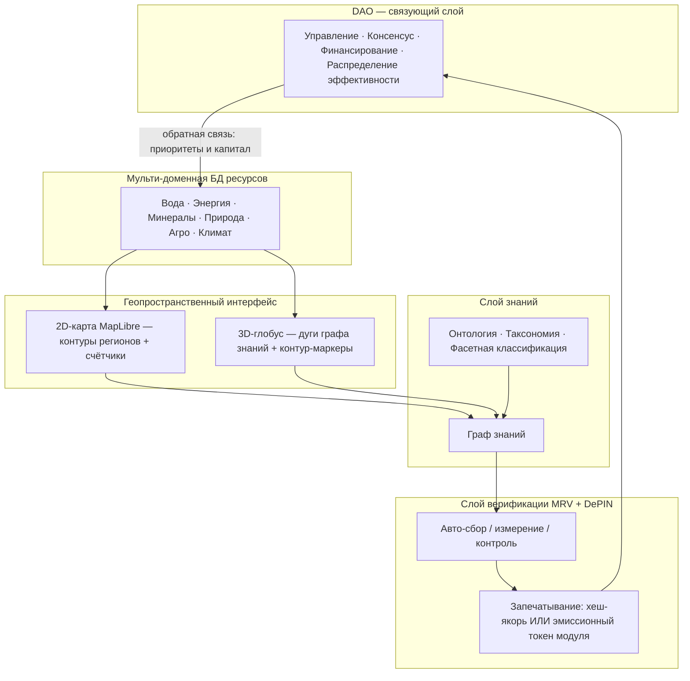

# ArkheOSium — операционная система экосистемы ресурсов и жизни планеты

> Технико-экономический документ (whitepaper) для инвесторов и партнёров.
> Версия 1.1 · Флагман: Проект «Аральское море» · Продакшн: `arkheosium.vercel.app`

---

## 1. Аннотация / резюме

**ArkheOSium** — это операционная система (ОС) для экосистемы ресурсов и жизни человечества, планеты и цивилизации. Как классическая ОС управляет ресурсами компьютера, ArkheOSium управляет ресурсами Земли: водой, энергией, минералами, природой, сельским хозяйством и климатом — сводя разрозненные данные, знания, инженерию и капитал в единый управляемый контур.

Технологически ArkheOSium — это реально работающее веб-приложение (React + TypeScript + Vite), развёрнутое на Vercel. Оно объединяет пять слоёв: **мульти-доменную базу данных ресурсов**, **двойной геопространственный интерфейс** (2D-карта + 3D-глобус), **слой знаний** (граф знаний поверх онтологии), **слой верификации** (MRV + DePIN с криптографическим запечатыванием данных) и **DAO** как связующий слой управления и финансирования.

ArkheOSium задумана не как набор веб-страниц, а как **цифровая операционная среда всей Инновационной лаборатории**: люди работают не «в приложении», а внутри Лаборатории, используя ArkheOSium как единую среду управления исследованиями, проектами, продуктами, знаниями, партнёрствами и капиталом. Лаборатория **FoxampyForge** при этом одновременно **работает внутри этой среды и создаёт/развивает** саму ОС; весь проект **принадлежит Лаборатории**, тогда как управление ведётся **через DAO**. Пользователь всегда находится внутри одного живого пространства, а меняется лишь уровень погружения и активный контекст — по принципу **Environment → Workspace → Object → Context → Action**.

**Для кого этот документ:** инвесторы, институциональные партнёры, правительства регионов и научные консорциумы, которым нужна прозрачная, верифицируемая и тиражируемая модель управления ресурсами. Флагманская витрина ОС — **Проект «Аральское море»**: региональная кампания «Каракалпакия» стоимостью **$250 млн** служит самодостаточным эталоном, а общая программа Проекта оценивается в **$0.5 трлн** с мультипликативной — а не аддитивной — рентабельностью и готовностью к развёртыванию в любом регионе Земли и за её пределами.

---

## 2. Проблема: ресурсы и жизнь планеты под давлением

Деградация экосистем — не абстракция, а измеримый системный сбой. Ключевой ресурс — **вода**: от неё зависят энергетика, сельское хозяйство, здоровье населения и климатическая стабильность. Разрушение водного баланса запускает каскад: пересыхание водоёмов → пыльные бури и засоление почв → потеря биоразнообразия → социальная и экономическая деградация региона.

Аральское море — хрестоматийный пример этого каскада: одно из крупнейших внутренних морей планеты сократилось до фрагментов, оставив десятки тысяч квадратных километров токсичной пустыни Аралкум и поставив под угрозу миллионы людей в южном Приаралье.

Корневая проблема — **фрагментарность управления**. Данные о ресурсах разрознены, знания заперты в отраслевых силосах, инвестиции идут «по обещаниям», а результаты не поддаются независимой проверке. Каждый вектор (вода, энергия, экология, наука, экономика, социум) оптимизируется отдельно — и суммарный эффект оказывается ниже потенциала. Требуется **системная интеграция**, в которой измерение, знание, инженерия и капитал работают как единый организм.

---

## 3. Видение и миссия

**Видение:** единый путь к всеобщему процветанию через модульные системы и кампании, связывающие все векторы — экологию, знания/R&D, экономику, науку и социальные программы. Процветание достижимо только при прямой интеграции всех проектов и кампаний — и именно это реализует Проект «Аральское море» как первая витрина ОС.

**Миссия ArkheOSium** — быть «операционной системой экосистемы ресурсов и жизни»: слоем, который делает состояние планетарных ресурсов наблюдаемым, знание — связным, результат — верифицируемым, а капитал — направляемым по доказанной эффективности. ОС не заменяет исполнителей на местах — она даёт им общую среду, стандарт данных и механизм консенсуса, позволяющий тиражировать успешную региональную кампанию по всей Земле и за её пределами (колонизация, новые сферы интегрирования).

---

## 4. Архитектура ОС

ArkheOSium построена из пяти взаимосвязанных слоёв. Нижние слои поставляют данные и факты, верхние — смысл и управление.

- **Слой 1 — мульти-доменная БД ресурсов.** Единая база объектов и субъектов по шести доменам с канонической палитрой (см. раздел 6). Каждый объект привязан к территории, домену и вектору.
- **Слой 2 — двойной геопространственный интерфейс.** *2D-карта* (`src/components/map/WaterMap.tsx`) на MapLibre рисует контуры регионов по заданным территориальным границам с табличкой «название + количество объектов», группируя объекты по уровню зума. *3D-глобус* (`src/pages/EarthGlobePage.tsx`) на react-three-fiber показывает дуги графа знаний и контур-маркеры регионов, раскрывая отдельные метки при приближении.
- **Слой 3 — граф знаний.** Онтологическая систематизация связывает модули и библиотеки по каждому вектору (инженерия, наука/R&D, экономика, экология, социум).
- **Слой 4 — верификация (MRV + DePIN).** Продукты автоматически собирают, измеряют и контролируют данные и немедленно запечатывают их — хешем или эмиссионным токеном самого модуля контура.
- **Слой 5 — DAO.** Связующий слой управления, консенсуса, финансирования и распределения эффективности между модулями.

Контуры задаются на всех уровнях иерархии: **регион → кампания → модуль → вектор → общая программа**.

---

## 5. Операционная среда: онбординг, кластеры, модули

Поверх пяти технических слоёв ArkheOSium разворачивается как **единая операционная среда инноваций (Innovation Operating System)** — не сайт со страницами, а цифровой двойник всей Инновационной лаборатории, где люди, идеи, процессы, продукты, исследования и партнёрства отображаются как единый живой организм. Именно это отличает ОС от инструментов вроде Notion, Jira или Confluence: те управляют отдельными сущностями, а ArkheOSium визуализирует и сопровождает всю организацию как динамическую систему.

Среда устроена в четыре уровня погружения: **Onboarding → Living Ecosystem → Workspaces → Objects**.

**Онбординг** — короткое (5–15 минут) знакомство, а не регистрация: живое ядро собирается из частиц, раскрывается в исследования, проекты, людей, компании, AI, документы и DAO, после чего пользователь выбирает **роль** (исследователь, партнёр, компания, инвестор, разработчик, эксперт, студент, государство) и **интересы** (вода, экология, AI, архитектура, блокчейн, дизайн, smart city и др.). Роль полностью меняет дальнейший UX, а созданный цифровой профиль-аватар вводит пользователя в ОС.

**Living Ecosystem** — главный экран вместо привычной домашней страницы: в центре живое ядро **Living Core**, отражающее текущее состояние всей экосистемы, от которого расходятся связи к проектам, лабораториям, компаниям, документам, AI, DAO, людям и технологиям. Навигация строится не через меню, а через **живой граф знаний** и **универсальную командную строку** (по образцу VS Code / Obsidian): ввод запроса мгновенно перестраивает пространство вокруг нужного объекта.

**Модель живых кластеров** заменяет дерево департаментов: Innovation Core, Research, Engineering, Design, Product, Startup, Project, Knowledge, Partnership, Investment, Education, Operations. Кластер — не кнопка, а полноценное цифровое пространство, которое при приближении трансформируется в рабочую область (например, «Проекты» → портфель → конкретный проект → его задачи, документы, граф зависимостей, участники и аналитика) без выхода из системы.

**Модульная архитектура.** ОС состоит из ~18 базовых модулей, каждый существует одновременно как самостоятельное рабочее пространство и как объект в общем графе:

| Модуль | Назначение |
|---|---|
| Living Core | Центральное ядро состояния экосистемы |
| Laboratory | Лаборатория, кластеры, департаменты, исследования |
| Projects | Все проекты и их жизненный цикл |
| Products | Продукты, технологии, сервисы |
| Startups | Инкубатор и акселератор стартапов |
| Organizations | UnicapInvest, партнёры, университеты, органы власти |
| Collaborations | Совместные программы, консорциумы, DAO-группы |
| Knowledge Graph | Семантический граф знаний |
| Documents | Whitepaper, стандарты, исследования, регламенты |
| AI Workspace | Специализированные ИИ-агенты |
| Goals & OKR | Стратегия, цели, KPI, ключевые результаты |
| Roadmaps | Дорожные карты, этапы, зависимости |
| Tasks | Задачи, спринты, Kanban, Gantt |
| Grants & Funding | Гранты, инвестиции, заявки, доноры |
| Analytics | Метрики, BI, прогнозы, влияние проектов |
| Community | Эксперты, команды, коммуникации, события |
| Resources | Финансы, оборудование, интеллектуальные активы |
| Settings & Identity | Профиль, роли, права доступа, персонализация |

**Единая система объектов.** Любой объект ОС — проект, компания, документ, человек, партнёр, технология — имеет одинаковую структуру: обложка → описание → связи → документы → AI → история → комментарии → метрики → действия. Переходы реализуются не как исчезновение страниц, а как масштабирование и трансформация: контекст не теряется.

**AI Workspace** — не чат, а среда из нескольких специализированных агентов (Architect, Researcher, Lawyer, Engineer, Designer, Analyst, Grant Writer, Investor), которые «знают» всю экосистему: могут показать связи между проектами (например, как связаны Aral Nexus и VOD.eco), перестроить карту под запрос или собрать все проекты по направлению.

**Слой экосистемы (Ecosystem).** Внутри ОС проекты и направления существуют как связанные узлы единой экосистемы: **Aral Nexus**, **VOD.eco**, **Ethosium**, **Innovation Lab**, **AI**, **Education**, **DAO**. Каждый крупный проект (например, Aral Nexus) раскрывается как собственная мини-ОС: Overview, Modules, Research, Timeline, Funding, Partners, Documents, Simulation, Roadmap.

Такой подход превращает ОС из презентации в рабочую платформу: по мере роста экосистемы не требуется менять структуру — достаточно добавлять новые модули, узлы и связи.

---

## 6. Модули и векторы

ОС организует деятельность по **пяти векторам** и **шести ресурсным доменам** с канонической цветовой палитрой (синхронизирована во всём приложении):

| Домен | Цвет (hex) | Роль |
|---|---|---|
| Вода | `#00e6c8` | Ключевой ресурс — опреснение, гидробаланс, рекуперация |
| Энергия | `#f59e0b` | ВИЭ, накопители, зелёный водород |
| Минералы | `#c084fc` | Экспорт из рассола, логистика |
| Природа | `#34d399` | Восстановление экосистем, биоразнообразие |
| Агро | `#a3e635` | Биокупола, солеустойчивые культуры |
| Климат | `#7dd3fc` | Мониторинг, климат-моделирование |

**Векторы:** научно-исследовательский, экономический, инженерный, экологический, социальный. Реальные модули кампании «Каракалпакия» (из `src/data/karakalpak-campaign.ts`):

| Модуль | Вектор | Домен | Назначение | Метрика |
|---|---|---|---|---|
| Вода и опреснение | Инженерный | Вода | Солнечное опреснение и рециркуляция | 480 000 м³/сут |
| Солнце + ветер + накопители | Инженерный | Энергия | Гибридное поле ВИЭ + зелёный водород | 3,2 ГВт |
| Агро-биокупола | Экономический | Агро | Вертикальные фермы, аквапоника, галофиты | 120 га |
| Эко-город | Социальный | Природа | Биоклиматический «15-минутный город» | 45 000 жителей |
| Логистика и порт | Экономический | Минералы | Мультимодальный узел, экспорт минералов | 2,4 млн т/год |
| R&D-кампус | Научно-исслед. | Климат | Открытая наука, полигон прототипов | 1 200 исследователей |
| Сеть мониторинга | Инженерный | Климат | Цифровой двойник + поток верифицируемых данных | 52 000 датчиков |

Каждый модуль подключён к DAO и к потоку верифицируемых данных, а его эффект по вектору агрегируется в общую эффективность программы.

---

## 7. Слой знаний: онтологическая систематизация

Знания ArkheOSium систематизированы научно корректным образом — как **онтологическая систематизация**, реализованная в виде **графа знаний (knowledge graph)** поверх **таксономии** и **фасетной классификации**.

- **Онтология** — формальное машиночитаемое представление области: сущности, свойства и связи, обеспечивающее интеграцию между векторами.
- **Граф знаний** — узлы (библиотеки/модули) и рёбра (семантические связи); дуги графа уже визуализируются на 3D-глобусе.
- **Таксономия** — иерархия «вектор → модуль → задача».
- **Фасетная классификация** — классификация по нескольким независимым фасетам одновременно (например: технология · TRL · модуль).

**Библиотеки знаний** — узлы онтологии, собственные и партнёрские, по областям каждого вектора:

| Библиотека | Домен | Тип | Фасет |
|---|---|---|---|
| Инженерная | Инженерия | своя | технология · TRL · модуль |
| Научно-исследовательская | Наука | своя | дисциплина · метод · датасет |
| Библиотека воды | Вода | своя | процесс · источник · качество |
| Энергетическая | Энергия | партнёр | генерация · хранение · баланс |
| Агро-биологическая | Агро | партнёр | культура · цикл · субстрат |
| Экологическая | Экология | своя | экосистема · вид · индикатор |
| Социально-правовая | Социум | партнёр | сектор · норма · практика |

Связи между библиотеками (рёбра онтологии) задают семантику интеграции: инженерия ↔ наука ↔ вода ↔ энергия ↔ агро ↔ экология ↔ социум образуют связный граф, а не набор изолированных силосов.

---

## 8. Верификация и токенизация данных (MRV + DePIN)

Доверие инвестора строится на проверяемости. ArkheOSium встраивает верификацию в саму точку измерения по стандарту **MRV** (Measurement, Reporting, Verification) на инфраструктуре **DePIN** (Decentralized Physical Infrastructure).

Продукты каждого модуля автоматически собирают, измеряют и контролируют данные и **немедленно запечатывают** их одним из двух способов:

1. **Хеш-якорь (hash-anchoring)** — измерение фиксируется криптографическим хешем on-chain как неизменяемое доказательство факта.
2. **Эмиссионный токен** — данные токенизируются **самим модулем контура** прямо в точке замера: измерение становится верифицируемым активом (`data → asset`).

| Продукт | Модуль | Печать | Что фиксирует |
|---|---|---|---|
| Счётчики воды и качества | Опреснение | Хеш-якорь | Объём и качество пресной воды |
| Энергетический оракул | Энергия | Токен эмиссии | Выработка ВИЭ |
| Агро-телеметрия | Агро | Хеш-якорь | Урожайность, расход воды и нутриентов |
| Экологический MRV | Мониторинг | Токен эмиссии | Поглощение CO₂ → углеродные токены |
| Логистический реестр | Порт | Хеш-якорь | Грузооборот, экспорт минералов |
| Контроллер микрогрида | Мониторинг | Токен эмиссии | DePIN-узлы токенизируют потоки |

Каждый контур (**регион → кампания → модуль → вектор**) эмитирует собственный верифицируемый поток. Потоки агрегируются в общую эффективность программы и поступают в DAO, где капитал направляется в модули по доказанным результатам, а не по обещаниям.

---

## 9. Экономика

Экономическая модель ArkheOSium строится на двух уровнях: региональная кампания-эталон и глобальная программа.

| Уровень | Оценка | Смысл |
|---|---|---|
| **Кампания «Каракалпакия»** | **$250 млн** | Самодостаточный региональный эталон; окупается внутри региона; все векторы в одном контуре |
| **Общая программа Проекта** | **$0.5 трлн ($500 млрд)** | Тиражирование по всем регионам Земли и за её пределами; рентабельность в разы выше |

**Ключевой тезис — мультипликативность, а не аддитивность.** Общая программа стоит и приносит больше суммы отдельных кампаний, потому что интеграция всех векторов даёт **системный множитель**. Кампания «Каракалпакия» рентабельна сама по себе; общая программа — мультипликативно рентабельнее за счёт совместной работы всех модулей, систем и кампаний как единого организма.

Эффекты кампании по векторам (агрегируются в общую эффективность):

| Вектор | Эффект | Показатель |
|---|---|---|
| Научно-исследовательский | Открытая наука и полигон технологий | ~85 патентов/год |
| Экономический | Самоокупаемый региональный контур | 28 000 рабочих мест |
| Инженерный | Цифровой двойник и автоматизация | 52 000 датчиков в сети |
| Экологический | Восстановление экосистемы | 18 000 га восстановлено |
| Социальный | Здоровье, образование, среда | ~3 млн человек под влиянием |

Модель тиражируема: та же архитектура кампании разворачивается в любом регионе — «где бы мы ни были», включая колонизацию других планет и новые сферы интегрирования.

---

## 10. Флагман: Проект «Аральское море» как витрина ОС

Проект «Аральское море» — первая полная демонстрация всех пяти слоёв ОС в действии, поданная как иммерсивная презентация.

**Маршрут витрины `/journey → /aral`:**

1. **`/journey`** (`src/pages/EcoJourneyPage.tsx`) — онбординг-таймлапс истории планетарной воды (−10 000 лет → 2026 → +100 лет наблюдаемого будущего) вокруг «чистого» глобуса: ледники, реки, ирригация, усыхание Арала, дефицит, «угасание».
2. **Возврат в настоящее** — раскрываются метки как контуры регионов с табличками; пульсирует Средняя Азия; центрирование на Аральском море → попап «Проект Аральское море».
3. **`/aral`** (`src/pages/AralSeaProjectPage.tsx`) — split-раскладка: sticky-карта Центральной Азии (левая половина / верх на мобильном) + скролл-главы справа. Карта авто-зумит области под активную главу (`IntersectionObserver` → `flyTo`).
4. **Выбор программы** (`src/components/eco/DualProgramStage.tsx`) — любой путь раскрывает параллельный split «общая программа $0.5 трлн × кампания $250 млн» со знаком «×» и плашкой мультипликативности.
5. **Каракалпакский deep-dive** (`src/components/eco/KarakalpakCampaign.tsx`) — экономика → эффекты по 5 векторам → модули → граф знаний библиотек → DAO → продукты MRV/DePIN.

Мастерплан включает зоны: жилой эко-квартал, опреснение и вода, возобновляемая энергетика, агро-биокупола, логистика/порт, R&D-кампус — с восстановлением береговой линии, водно-болотных угодий и лесополос против пыльных бурь. Обзор остальных кампаний добавляет город-остров в центре восстановленного моря и переброс паводковых вод из Сибири.

Флагман доказывает главный тезис ОС: только прямая интеграция всех векторов и контуров ведёт к процветанию.

---

## 11. Дорожная карта

Кратко (детальная версия — в отдельном документе `04-roadmap-unicap-lab-karakalpak.md`):

- **Этап 1 — Витрина и эталон.** Полный запуск презентации `/journey → /aral`, кампания «Каракалпакия» как самодостаточный референс. *(в основном реализовано)*
- **Этап 2 — Верификационный контур.** Промышленное развёртывание сети MRV/DePIN, on-chain хеш-якорение и эмиссионные токены модулей.
- **Этап 3 — DAO и капитал.** Полноценный DAO-слой: голосование за приоритеты, финансирование по верифицируемым результатам, распределение эффективности.
- **Этап 4 — Тиражирование.** Развёртывание кампаний по регионам Земли; подключение партнёрских библиотек знаний.
- **Этап 5 — За пределами Земли.** Новые сферы интегрирования и колонизация как продолжение модели.

---

## 12. Заключение

ArkheOSium превращает управление ресурсами и жизнью планеты из набора разрозненных отраслевых усилий в единую операционную систему: наблюдаемую (2D-карта + 3D-глобус), связную (граф знаний поверх онтологии), проверяемую (MRV + DePIN с хеш-якорением и токенами модулей) и управляемую по доказанной эффективности (DAO). Кампания «Каракалпакия» ($250 млн) доказывает жизнеспособность модели на одном регионе; общая программа ($0.5 трлн) раскрывает её мультипликативную ценность при интеграции всех векторов и готовность к тиражированию по всей Земле и за её пределами.

Для инвестора и партнёра это означает три вещи: **прозрачность** (каждый факт запечатан и проверяем), **тиражируемость** (эталонная кампания как рабочий шаблон) и **мультипликативную отдачу** (интеграция даёт системный множитель, а не арифметическую сумму). Проект «Аральское море» — не обещание, а работающая витрина этой операционной системы.
