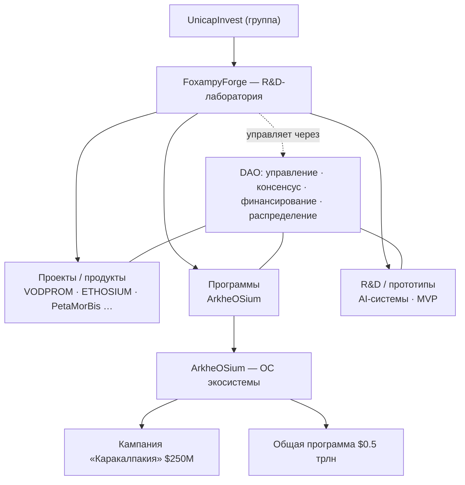
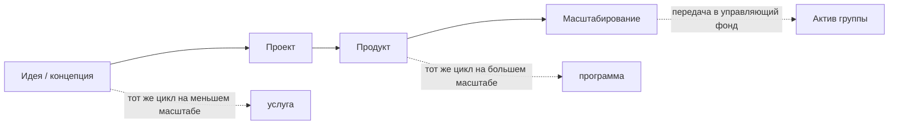

# FoxampyForge — исследовательско-инновационная лаборатория экосистемы

> **Из идеи и концепции — в проект и продукт.** Экосистема проектов, услуг и инвестиций.

---

## 1. Аннотация

**FoxampyForge** (далее — Лаборатория) — это исследовательское и инновационное подразделение международной инвестиционной группы **UnicapInvest**. Лаборатория превращает сырые идеи и концепции в работающие цифровые продукты, платформы и целые программы, а затем — в управляемые активы и инвестиционные инициативы.

В отличие от классического продуктового агентства, FoxampyForge устроена как **OS-подобный стартап-хаб**: у неё есть каталог приложений-продуктов (**App Hub**), маркетплейс услуг, внутренний аккаунт с кошельком и токеном **«Искра» (✦)**, стейкинг и поток заказа услуг. Всё это работает поверх единой методологической и управленческой основы — **фрактальной методологии** полного цикла разработки и **DAO** как связующего слоя управления, консенсуса, финансирования и распределения эффективности.

Флагманский проект Лаборатории — **ArkheOSium**, операционная система для экосистемы ресурсов и жизни. Лаборатория **одновременно работает внутри ArkheOSium и создаёт/развивает** её: она живёт в среде ОС и является её разработчиком. Весь проект (ArkheOSium и его экосистема) **принадлежит Лаборатории**, но управление ведётся **через DAO**. В контуре ОС разворачивается **кампания «Каракалпакия»** ($250 млн) как эталонный региональный модуль внутри **общей программы Проекта на $0,5 трлн**.

Настоящий документ описывает роль Лаборатории, её экономику, DAO, связь с ArkheOSium и портфель направлений. Место FoxampyForge внутри группы UnicapInvest подробно раскрыто в документе **03**.

---

## 2. Позиционирование: R&D-подразделение группы UnicapInvest

Согласно собственному описанию, FoxampyForge — это «сайт исследовательского / инновационного подразделения группы **UnicapInvest**». Формулировка в материалах группы: *«FoxampyForge — департамент исследований и инновационных разработок… исследовательский контур группы UnicapInvest: изучаем новые рынки и технологии, проектируем цифровые продукты и платформенные решения и доводим их до стадии передачи в управляющий фонд для масштабирования»*.

UnicapInvest — международная инвестиционная группа, управляющая капиталом и портфелем активов в реальных секторах экономики:

| Метрика группы | Значение |
|---|---|
| Под управлением | €200M |
| Портфель активов | €1.7B |
| Офисов | 8 |

Группа работает в секторах: **здравоохранение, промышленность, энергетика, инфраструктура, жильё**. Флагманская инициатива группы — **VODPROM** (цифровая платформа управления водными и земельными ресурсами, в контуре которой — Token Vodprom и партнёрство Culligan).

Роль FoxampyForge в этой конструкции однозначна: это **инновационный двигатель группы**. Лаборатория ведёт разведку рынков и технологий, собирает продукты «из идеи в продукт» и передаёт зрелые решения в управляющий фонд для масштабирования. Девиз группы, который наследует и Лаборатория: *«Цена величия — ответственность»*.

---

## 3. Что Лаборатория создаёт и чем управляет

FoxampyForge одновременно **создаёт** и **управляет** тремя классами сущностей — проектами, программами и R&D-инициативами:

- **Проекты (продукты).** Портфель приложений-продуктов, каждое в активной разработке и открытое для инвестиций и стейкинга: **VODPROM** (флагман, платформа водных/земельных ресурсов), **ETHOSIUM** (цифровая ОС личности), **PetaMorBis** (цифровой зоополис), **EthosLife** (привычки и цели), **FlowBook** (поток заметок и знаний), **CreamSale** (витрина и продажи).
- **Программы.** Долгосрочные многомодульные инициативы. Флагман — **ArkheOSium** и её экологическая программа «Путь к всеобщему процветанию», внутри которой живёт кампания «Каракалпакия».
- **R&D.** Прикладные исследования и прототипы: внутренние AI-системы, экспериментальные MVP, закрытый стейкинг-пул как приватная инвестиционная инициатива.

Управление всем этим портфелем — не ручное, а системное: приоритеты, финансирование и распределение эффективности проходят через **DAO Лаборатории** (раздел 6).

---

## 4. Модель «из идеи в продукт»: фрактальная методология

Ядро Лаборатории — **фрактальная методология**: одна и та же логика полного цикла повторяется на каждом масштабе — от отдельной услуги до целой программы. В визуальном языке сайта Лаборатории это выражено мотивом «живой материи»: WebGL-фон «песка времени», поверх которого лежат «высеченные в камне плиты» — метафора решений, обретающих постоянство и вес.

Полный цикл проходит **8 стадий**:

| # | Стадия | Суть |
|---|---|---|
| 1 | Исследование | Рынок, пользователи, технологии → карта возможностей и гипотезы. |
| 2 | Стратегия | Бизнес-модель, приоритеты, дорожная карта, критерии успеха. |
| 3 | Систематизация | Данные, процессы и требования сводятся в единую логику. |
| 4 | Архитектура | Сущности, связи, потоки данных, техническая основа под нагрузку. |
| 5 | Брендирование | Позиционирование, вербальная и визуальная идентичность. |
| 6 | Дизайн | UX/UI и дизайн-система, готовая к разработке. |
| 7 | Разработка | Инженерия, выдерживающая нагрузку; AI/автоматизация как инструмент. |
| 8 | Рост | Запуск, аналитика, масштабирование, передача в управляющий фонд. |

«Фрактальность» означает, что этот цикл — самоподобен: услуга проходит его в миниатюре, продукт — целиком, программа — как совокупность вложенных циклов модулей. Так идея масштабируется без потери связности:

Форматы работы, в которых цикл предлагается рынку: **отдельные услуги** (один этап цикла), **полный цикл** (сквозная разработка под ключ) и **Venture Builder** (совместное создание продукта как долгосрочное партнёрство).

---

## 5. Внутренняя экономика Лаборатории

FoxampyForge реализована как OS-подобный хаб с собственной внутренней экономикой. Ключевые контуры:

- **App Hub** — каталог приложений-продуктов Лаборатории. Каждый продукт представлен карточкой со стадией готовности, направлением и открытостью к инвестициям/стейкингу.
- **Маркетплейс услуг** — таксономия услуг по направлениям (исследования, стратегия, брендинг, AI, инженерия и др.) с потоком заказа услуги.
- **Аккаунт и кошелёк** — личный контур пользователя с внутренним токеном **«Искра» (✦)**.
- **Стейкинг** — механика удержания/участия; в портфеле есть и **закрытый стейкинг-пул** как отдельная приватная инициатива.
- **Поток заказа услуг** — сквозной сценарий: вход → выбор услуги/продукта → оформление заявки.

Токен **«Искра» (✦)** — внутренняя единица ценности хаба: он связывает потребление услуг, участие в продуктах и стейкинг в единый экономический контур. Экономика построена на премиальном liquid-glass интерфейсе и подаётся как **экосистема проектов, услуг и инвестиций**, а не как разрозненный набор функций.

> **Дисклеймер.** Инвестиционно-стейкинговые разделы Лаборатории носят информационный характер и не являются инвестиционной рекомендацией или обещанием доходности.

---

## 6. DAO Лаборатории

Управление портфелем проектов, программ и R&D осуществляется через **DAO** — связующий слой системности и интеграции. DAO решает четыре задачи:

| Функция | Что делает |
|---|---|
| **Управление** | Держатели голосуют за приоритеты модулей и распределение ресурсов. |
| **Консенсус** | Решения фиксируются on-chain — прозрачно и невозвратно для всех контуров. |
| **Финансирование** | Пул капитала направляется в модули **по верифицируемым результатам, а не по обещаниям**. |
| **Распределение эффективности** | Эффект каждого модуля агрегируется и справедливо распределяется между участниками и командами. |

Принцип «финансирование по верифицируемым результатам» — центральный. DAO не раздаёт капитал под декларации: каждый модуль (проект, команда, контур) поставляет **верифицируемый поток данных** (см. раздел 7), из которого складывается его измеримая эффективность. Именно эта эффективность агрегируется и становится основанием для распределения ресурсов и вознаграждения. Так DAO превращает разрозненные команды в единый организм, где вклад каждого измерим и справедливо учтён.

---

## 7. Связь с ArkheOSium: граф знаний, MRV/DePIN, токенизация

**ArkheOSium** — флагманская программа Лаборатории и одновременно её «производственная площадка», на которой инструменты FoxampyForge проявляются в продукте. Более того, ArkheOSium служит **цифровой операционной средой самой Лаборатории**: команды работают не «в приложении», а внутри Лаборатории, используя ОС как единое пространство управления исследованиями, проектами, знаниями и партнёрствами (онбординг, живые кластеры, граф знаний, AI-агенты). Детальная архитектура этой среды раскрыта в документе **01**. Ключевые инструменты связи:

**Граф знаний и онтология.** Знания каждого вектора хранятся как **библиотеки знаний** (собственные + партнёрские), связанные в **онтологический граф знаний (knowledge graph)** над **таксономией** и **фасетной классификацией**. Онтология — это формальное, машиночитаемое представление области: сущности, свойства и связи, обеспечивающее интеграцию между доменами. Библиотеки — узлы графа; связи между ними задают семантику интеграции модулей.

| Библиотека | Домен | Тип |
|---|---|---|
| Инженерная | Инженерия | своя |
| Научно-исследовательская | Наука | своя |
| Библиотека воды | Вода | своя |
| Энергетическая | Энергия | партнёрская |
| Агро-биологическая | Агро | партнёрская |
| Экологическая | Экология | своя |
| Социально-правовая | Социум | партнёрская |

**MRV + DePIN.** Продукты Лаборатории автоматически **измеряют, фиксируют и верифицируют** данные каждого модуля (Measurement, Reporting, Verification) поверх децентрализованной физической инфраструктуры (DePIN). Каждое измерение сразу **запечатывается**: либо криптографическим **хешем** (неизменяемое доказательство факта), либо **токеном эмиссии самого модуля** (данные становятся верифицируемым активом прямо в точке замера).

**Токенизация.** Каждый контур — регион → кампания → модуль → вектор — эмитирует собственный верифицируемый поток. Потоки агрегируются в общую эффективность программы и в DAO. Так граф знаний, MRV/DePIN и токенизация вместе образуют замкнутую петлю: измеримое знание → верифицируемый актив → управленческое решение.

---

## 8. Портфель направлений / векторов

Лаборатория ведёт **семь направлений** («направлений» в терминах сайта Лаборатории), закрывающих полный цикл — от исследования до жизни продукта в экосистеме:

| Направление | Фокус |
|---|---|
| Инновационные исследования | Рынки, отрасли, пользователи, технологии — поиск неочевидных возможностей. |
| Бизнес-стратегия | Бизнес-модель, концепции, архитектура решений. |
| Бренд-системы | Стратегия, вербальная и визуальная идентичность, brandbook. |
| Продуктовый дизайн | UX/UI, прототипы, дизайн-системы. |
| AI и автоматизация | AI-агенты, автоматизация процессов, интеллектуальные системы. |
| Цифровая инженерия | Веб-платформы, SaaS, мобильные приложения, MVP. |
| Развитие экосистемы | Запуск, рост, интеграция в UnicapInvest, масштабирование. |

В прикладной плоскости (на примере ArkheOSium/Каракалпакии) эти направления разворачиваются в **пять векторов эффективности**: **научно-исследовательский**, **экономический**, **инженерный**, **экологический** и **социальный**. Каждый вектор наполнен конкретными модулями продуктов — от воды и опреснения, гибридной энергетики и агро-биокуполов до эко-города, логистики/порта, R&D-кампуса и сети мониторинга (52 000 датчиков). Эффект по векторам агрегируется в общую эффективность программы через DAO.

---

## 9. Как Лаборатория входит в UnicapInvest

FoxampyForge — **исследовательско-инновационный контур** группы UnicapInvest. Схема взаимодействия проста и односторонне-восходящая: Лаборатория порождает и вынашивает продукты и программы, доводит их до зрелости и **передаёт в управляющий фонд группы** для масштабирования и превращения в актив портфеля. Обратно Лаборатория получает капитал, доступ к секторам группы (здравоохранение, промышленность, энергетика, инфраструктура, жильё) и связь с флагманскими инициативами (VODPROM). Полная модель встраивания, потоки капитала и права — в документе **03**.

---

## 10. Заключение

FoxampyForge — это не студия и не фонд, а **лаборатория полного цикла**, которая соединяет три обычно разрозненных мира: создание продуктов, управление ими и их финансирование. Фрактальная методология даёт воспроизводимый путь «из идеи в продукт» на любом масштабе; внутренняя экономика (App Hub, услуги, «Искра», стейкинг) делает Лабораторию самодостаточным хабом; DAO превращает управление в прозрачную, верифицируемую и справедливую систему; а ArkheOSium — с её графом знаний, MRV/DePIN и токенизацией — служит и флагманской программой, и витриной инструментов.

Кампания «Каракалпакия» ($250 млн) как эталонный модуль внутри общей программы на $0,5 трлн показывает главный тезис Лаборатории: **эффективность интегрированной системы мультипликативна, а не аддитивна**. Именно эту мультипликативность FoxampyForge и производит — превращая идеи в продукты, продукты в программы, а программы — во всеобщее процветание.
