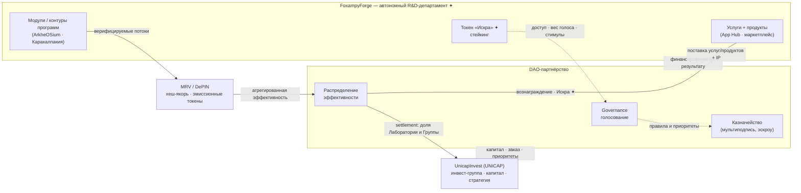

# Лаборатория FoxampyForge × UnicapInvest: автономный R&D-департамент и DAO-партнёрство

> Whitepaper 03 — модель интеграции исследовательской лаборатории FoxampyForge в инвестиционную группу UnicapInvest: автономная работа как R&D-департамент при поставке всех услуг и продуктов через DAO-партнёрство.

---

## 1. Аннотация

Настоящий документ описывает организационно-экономическую модель, в которой **исследовательская лаборатория FoxampyForge** («Лаборатория», ✦) существует как **инновационное подразделение группы UnicapInvest** («UNICAP», «Группа»), но действует **автономно**: ведёт собственную R&D-повестку, оперирует внутренним токеном «Искра» (✦) и управляет своими проектами и программами через **DAO-механику**. Флагманский проект ArkheOSium **принадлежит Лаборатории**, которая **одновременно работает внутри его среды и создаёт/развивает** его; при этом всё управление проектом ведётся **через DAO**.

Ключевой тезис: **всё, что Лаборатория производит — услуги, продукты, интеллектуальную собственность и подтверждённую эффективность программ — она поставляет Группе (и внешним партнёрам) через DAO-партнёрство**. Поставка, расчёты, распределение ценности и подтверждение результата совершаются on-chain: смарт-контракты фиксируют услуги и продукты, а верифицируемые потоки данных программ (MRV/DePIN, хеш-якорение, эмиссионные токены модулей) агрегируются в измеримую эффективность и распределяются между Лабораторией и UnicapInvest по прозрачным правилам казначейства.

Такая конструкция соединяет две логики: **вертикальную** (Лаборатория — департамент Группы, встроенный в её стратегию и капитал) и **горизонтальную** (Лаборатория — самостоятельный участник DAO, продающий результат по факту, а не по обещанию). Эталоном служит кампания «Каракалпакия» (**$250 млн**, самодостаточна), масштабируемая до общей программы (**$0.5 трлн**, мультипликативный эффект).

---

## 2. Стороны партнёрства

| Сторона | Что это | Роль в партнёрстве |
|---|---|---|
| **UnicapInvest (UNICAP)** | Инвестиционная группа — материнская структура. Владеет капиталом, стратегией и портфелем. | **Заказчик и инвестор R&D.** Формирует стратегические приоритеты, предоставляет капитал, принимает результат (продукты, IP, эффективность) и монетизирует его на рынке. |
| **FoxampyForge (Лаборатория, ✦)** | Исследовательское/инновационное **подразделение группы UnicapInvest** (verbatim из README: «...подразделения группы UnicapInvest»). OS-подобный стартап-хаб: каталог продуктов (App Hub), маркетплейс услуг, аккаунт с кошельком, токен «Искра», стейкинг, поток заказа услуг. **Владелец проекта ArkheOSium**: одновременно работает внутри его среды и создаёт/развивает его. | **Автономный R&D-исполнитель и владелец ArkheOSium.** Превращает «идею и концепцию в проект и продукт», ведёт собственную научную повестку, управляет проектами через DAO, поставляет услуги/продукты Группе и партнёрам. |

**Разграничение ролей.** UnicapInvest отвечает на вопрос «**что** и **зачем**» на уровне стратегии и капитала; FoxampyForge отвечает на вопрос «**как**» на уровне исследований, инженерии и продукта. Связующим слоем между «зачем» Группы и «как» Лаборатории выступает DAO — именно там встречаются заказ, исполнение и расчёт.

---

## 3. Модель автономии

Автономия Лаборатории означает, что она самостоятельно управляет своим внутренним контуром, но синхронизирует стратегические и капиталоёмкие решения с Группой.

| Лаборатория решает **сама** (автономно) | Согласуется с **UnicapInvest** (совместно) |
|---|---|
| Собственная R&D-повестка: направления, приоритеты, полигоны прототипов | Стратегические приоритеты портфеля и вход в новые рынки/регионы |
| Внутренняя экономика: эмиссия и правила токена «Искра» ✦, стейкинг | Крупные капитальные транши и финансирование программ ($250M / $0.5T) |
| DAO-голосования по проектам и программам внутри Лаборатории | Условия и ставки распределения эффективности между Лабораторией и Группой |
| Выбор технологического стека, методология, состав команд-модулей | IP-политика верхнего уровня, лицензирование за пределами Группы |
| Каталог услуг и продуктов (App Hub, маркетплейс услуг) | Целевые SLA/KPI по программам, публичные обязательства Группы |

**Принцип.** Лаборатория автономна в *операциях и исследованиях*, но подотчётна Группе в *стратегии и капитале*. Автономия защищена технически: DAO-голосования и казначейство Лаборатории исполняются on-chain, а UnicapInvest участвует как крупный стейкхолдер с правом голоса, а не как ручной оператор.

---

## 4. DAO-партнёрство: как услуги и продукты поставляются через DAO

DAO — это не «надстройка», а **рельсы поставки**. Каждая услуга и каждый продукт Лаборатории оформляются, исполняются и оплачиваются через смарт-контракты. DAO выступает связующим слоем системности и интеграции: управление, консенсус, финансирование, распределение эффективности.

### 4.1. Роли и объекты

| Компонент DAO | Назначение |
|---|---|
| **Управление (governance)** | Держатели голосуют за приоритеты модулей и распределение ресурсов; UnicapInvest — крупный участник голосования. |
| **Консенсус (consensus)** | Решения фиксируются on-chain — прозрачно и невозвратно для всех контуров. |
| **Финансирование (funding)** | Пул капитала направляется в модули **по верифицируемым результатам, а не по обещаниям**. |
| **Распределение эффективности (distribution)** | Эффект каждого модуля агрегируется и справедливо распределяется между участниками. |
| **Казначейство (treasury)** | Мультиподписной пул: приём капитала от Группы, выплаты Лаборатории и модулям по достигнутым KPI. |
| **Смарт-контракты услуг/продуктов** | Оформляют заказ услуги, поставку продукта, передачу IP и триггерят расчёт по факту исполнения. |

### 4.2. Жизненный цикл поставки

1. **Заказ.** UnicapInvest (или партнёр) размещает заказ на услугу/продукт через маркетплейс Лаборатории; смарт-контракт фиксирует условия, KPI и объём эскроу.
2. **Исполнение.** Соответствующий модуль/команда Лаборатории выполняет работу; прогресс привязывается к верифицируемым потокам данных (см. §6).
3. **Верификация.** MRV/DePIN-продукты запечатывают результат хешем или эмиссионным токеном модуля — доказательство факта, а не отчёт-обещание.
4. **Расчёт.** По достижении KPI казначейство высвобождает средства и начисляет распределение эффективности между Лабораторией и Группой.
5. **Учёт IP.** Права на созданный продукт/решение фиксируются on-chain согласно IP-политике (см. §7).

---

## 5. Экономика взаимодействия

### 5.1. Токен «Искра» (✦) и стейкинг

«Искра» — **внутренний токен Лаборатории**, обслуживающий её собственный контур: доступ к услугам маркетплейса, стейкинг, стимулирование участников и вес в DAO-голосованиях по проектам Лаборатории. Это единица внутренней координации, отделённая от капитала Группы: UnicapInvest вносит капитал в казначейство DAO, тогда как «Искра» распределяет *операционную* мотивацию и права внутри Лаборатории.

**Стейкинг** выполняет двойную роль: (1) выравнивает интересы исполнителей-модулей с результатом (застейканная «Искра» «на кону» под KPI), (2) регулирует вес голоса и приоритетный доступ к заказам.

### 5.2. Связь с эмиссионными токенами модулей ArkheOSium

Помимо «Искры» как *внутренней* валюты, отдельные модули и контуры программ (ArkheOSium, кампания «Каракалпакия») эмитируют **собственные эмиссионные токены** прямо в точке измерения (например, энергетический оракул токенизирует выработку ВИЭ; экологический MRV эмитирует углеродные токены). Это разные слои:

| Слой | Токен | Что представляет | Где обращается |
|---|---|---|---|
| **Координационный** | «Искра» ✦ | Труд, доступ, права голоса внутри Лаборатории | Контур FoxampyForge |
| **Эмиссионный (модульный)** | Токены модулей/контуров | Верифицированный физический результат («данные → актив») | Программы / DAO |

Связь между слоями замыкается в казначействе DAO: эмиссионные токены модулей формируют **измеримую эффективность программы**, которая конвертируется в расчёты между Лабораторией и Группой, а часть возврата поступает исполнителям в «Искре».

### 5.3. Распределение эффективности

Эффект каждого модуля агрегируется и распределяется по правилам DAO. Финансирование идёт **по верифицируемым результатам**: чем больше подтверждённой эффективности сгенерировал контур, тем большую долю settlement он получает — и тем большую отдачу фиксирует UnicapInvest как инвестор.

---

## 6. Верификация ценности: от измерения до расчёта

Ценность в этой модели не декларируется — она **доказывается** и только затем оплачивается. Механика: **MRV + DePIN → hash-anchoring / эмиссионные токены → агрегация эффективности → settlement в DAO**.

- **MRV** (Measurement, Reporting, Verification) — измерение, отчётность, верификация.
- **DePIN** (Decentralized Physical Infrastructure) — децентрализованная физическая инфраструктура (датчики, оракулы, контроллеры микрогрида).

Каждый контур (**регион → кампания → модуль → вектор**) эмитирует собственный верифицируемый поток: измерение сразу запечатывается либо **криптографическим хешем** (неизменяемое доказательство факта), либо **эмиссионным токеном самого модуля** (данные становятся активом прямо в точке замера).

| Продукт данных | Модуль | Тип печати | Смысл |
|---|---|---|---|
| Счётчики воды и качества | Опреснение | Хеш-якорь | immutable proof объёма/качества воды |
| Энергетический оракул | ВИЭ | Токен эмиссии | data → asset: выработка как актив |
| Агро-телеметрия | Агро-биокупола | Хеш-якорь | immutable proof урожайности/расхода |
| Экологический MRV | Мониторинг | Токен эмиссии | углеродные токены (CO₂, восстановление) |
| Логистический реестр | Порт | Хеш-якорь | immutable proof грузооборота |
| Контроллер микрогрида | Мониторинг | Токен эмиссии | DePIN-узлы токенизируют потоки автономно |

**Цепочка расчёта:** потоки продуктов данных → агрегация в общую эффективность программы → правила распределения в DAO → settlement между Лабораторией (исполнитель) и UnicapInvest (инвестор). Так «отчёт» превращается в «доказательство», а «доказательство» — в «расчёт».

---

## 7. Юридически-организационный контур

Модель совмещает два статуса Лаборатории, которые не противоречат, а дополняют друг друга.

| Аспект | Как департамент UnicapInvest | Как автономная DAO-структура |
|---|---|---|
| **Статус** | Подразделение Группы, встроенное в её стратегию и отчётность | Самостоятельный участник DAO с собственным казначейством и голосом |
| **Услуги** | Внутренний R&D-сервис Группы | Поставляются через смарт-контракты маркетплейса, в т.ч. внешним партнёрам |
| **Продукты** | Пополняют портфель Группы | Оформляются и передаются on-chain по факту приёмки |
| **IP** | Верхнеуровневая IP-политика Группы | Права фиксируются on-chain; лицензирование — по правилам DAO |
| **Расчёты** | Бюджет/трансфертное ценообразование внутри Группы | Settlement по верифицированной эффективности через казначейство |

> **Модель, подлежит юридическому оформлению.** Конкретная правовая форма DAO (например, обёртка юрлица, статус токенов «Искра» и эмиссионных токенов, трансграничные аспекты, трансфертное ценообразование «департамент ↔ Группа») здесь описана на принципиальном уровне и требует отдельного юридического оформления. Приведённые механизмы задают *логику* отношений, а не готовую правовую конструкцию.

---

## 8. Управление рисками и прозрачность

| Риск | Механизм снижения |
|---|---|
| Оплата за необеспеченный результат | Финансирование только по верифицируемым результатам; эскроу до достижения KPI |
| Манипуляция данными | MRV/DePIN с хеш-якорением; данные неизменяемы после запечатывания |
| Непрозрачность решений | Все governance-решения фиксируются on-chain, невозвратно и публично аудируемо |
| Конфликт «департамент ↔ автономия» | Разграничение зон решений (§3); Группа голосует как стейкхолдер, а не оперирует вручную |
| Концентрация власти в голосовании | Веса через стейкинг «Искры»; правила кворума и распределения (подлежат настройке в DAO) |
| Правовая неопределённость | Явная маркировка «модель, подлежит юр-оформлению»; принципиальный уровень до оформления |

**Прозрачность как продукт.** Аудируемость здесь не побочный эффект, а поставляемое свойство: любая сторона может проверить цепочку «измерение → хеш/токен → агрегация → расчёт» on-chain. Это и есть основа доверия между автономной Лабораторией и инвестирующей Группой.

---

## 9. Масштабирование на другие программы и кампании

Модель спроектирована как **тиражируемый шаблон**, а не разовая договорённость.

| Уровень | Оценка | Смысл для партнёрства |
|---|---|---|
| **Кампания «Каракалпакия»** | **$250 млн** | Самодостаточный эталон: все векторы в одном контуре, каждый модуль подключён к DAO и потоку верифицируемых данных. Рабочий шаблон отношений Лаборатория ↔ Группа. |
| **Общая программа Проекта** | **$0.5 трлн** | Мультипликативный эффект: совместная работа всех модулей и кампаний как единого организма. Рентабельность **в разы выше** отдельной кампании. |

**Логика масштабирования.** Каждая новая кампания подключается к тем же рельсам: собственный DAO-контур, свои MRV/DePIN-продукты, свой поток эмиссионных токенов, агрегируемый в эффективность и settlement с Группой. Эффективность **не аддитивна, а мультипликативна** — интеграция всех векторов (экология, R&D, экономика, наука, соц. программы) даёт системный множитель. «Каракалпакия» отрабатывает шаблон; общая программа применяет его «где бы мы ни были», вплоть до новых сфер интеграции.

---

## 10. Заключение

FoxampyForge — это **автономный R&D-департамент UnicapInvest**, который поставляет Группе всё созданное — услуги, продукты, IP и подтверждённую эффективность — **через DAO-партнёрство**. Вертикальная встроенность в стратегию и капитал Группы сочетается с горизонтальной самостоятельностью Лаборатории в исследованиях и операциях, а связующим слоем выступает DAO: заказ, исполнение, верификация и расчёт совершаются on-chain.

Ключевое преимущество модели — **оплата по доказанному результату**: MRV/DePIN-потоки превращают физический эффект в неизменяемые доказательства и эмиссионные токены, те агрегируются в эффективность программы, а казначейство DAO распределяет ценность между Лабораторией и Группой. Отработанная на кампании «Каракалпакия» ($250 млн, самодостаточна), эта конструкция масштабируется до общей программы ($0.5 трлн) с мультипликативным эффектом — единый, прозрачный и тиражируемый механизм создания и распределения ценности.

> *Конкретные правовые детали DAO, статуса токенов и трансфертных расчётов приведены на принципиальном уровне и подлежат отдельному юридическому оформлению.*
