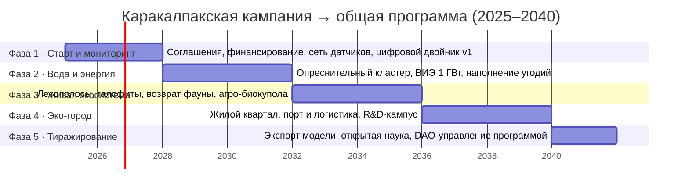

# Дорожная карта UnicapInvest × Лаборатория FoxampyForge

### Совместный рабочий план по всем программам и векторам с фокусом на Каракалпакскую кампанию

> Документ уровня whitepaper / roadmap. Согласован с приложением ArkheOSium: массивом `ROADMAP` (2025→2040) и данными кампании `karakalpak-campaign.ts`. Все суммы и метрики приведены к единой канонической базе: кампания «Каракалпакия» — **$250 млн**, общая программа Проекта — **$0,5 трлн**.

---

## 1. Аннотация

Настоящая дорожная карта фиксирует **совместный рабочий план** инвестиционной группы **UnicapInvest** («UNICAP») и её автономного научно-исследовательского департамента — **Лаборатории FoxampyForge** — по всему циклу «идея → продукт → масштаб» и по всем векторам: инженерному, научно-исследовательскому, экономическому, экологическому и социальному.

UnicapInvest выступает материнской инвестиционной группой и держателем капитального контура; Лаборатория FoxampyForge **одновременно работает внутри ArkheOSium и создаёт/развивает** её — операционную систему для экосистемы ресурсов и жизни. Проект **принадлежит Лаборатории**, управление ведётся **через DAO**, а продукты и сервисы поставляются через **DAO-партнёрство**.

Немедленный фокус карты — **Каракалпакская кампания**: самодостаточный региональный эталонный модуль на **$250 млн**, отрабатывающий подход, который затем мультипликативно тиражируется в рамках общей программы на **$0,5 трлн** — по регионам Земли и за её пределами.

Адресаты документа: инвестиционный комитет UnicapInvest, руководство Лаборатории, участники DAO, региональные и научные партнёры.

---

## 2. Принципы совместной работы

1. **Лаборатория как департамент + автономия.** FoxampyForge — подразделение UnicapInvest, но с собственным R&D-контуром, бюджетом на исследования и правом на технологический риск. UNICAP задаёт инвестиционные рамки и горизонт возврата; Лаборатория отвечает за инженерию, науку и продукт.
2. **DAO-партнёрство как связующий слой.** Управление приоритетами модулей, консенсус, финансирование по результату и распределение эффективности идут через DAO. Решения фиксируются on-chain — прозрачно и невозвратно для всех контуров.
3. **Полный цикл «идея → продукт → масштаб».** Каждая инициатива проходит путь: гипотеза в Лаборатории → прототип на полигоне R&D → верифицируемый модуль в кампании → тиражируемый шаблон в общей программе.
4. **Верифицируемость по умолчанию.** Любой результат подтверждается потоком MRV/DePIN: измерение запечатывается хеш-якорем либо эмиссионным токеном самого модуля. Капитал направляется по доказанным результатам, а не по обещаниям.
5. **Мультипликативность, а не аддитивность.** Ценность программы — больше суммы кампаний: интеграция векторов даёт системный множитель.

---

## 3. Общая карта программ и векторов

Матрица «векторы × уровни контуров» связывает пять векторов с четырьмя уровнями системности: **регион → кампания → модуль → программа**.

| Вектор | Регион (южное Приаралье) | Кампания «Каракалпакия» ($250M) | Ключевой модуль | Программа ($0,5T) |
|---|---|---|---|---|
| **Инженерный** | Деградация инфраструктуры, дефицит воды | Опреснение + микрогриды + логистика | Вода/опреснение · Энергия · Сеть мониторинга | Тиражируемый инженерный шаблон «под ключ» |
| **Научно-исследовательский** | Отсутствие полигона | R&D-кампус, открытая наука | R&D-кампус (1 200 исследователей) | Глобальная открытая наука и патентный пул |
| **Экономический** | Отток населения, безработица | Замкнутая экономика, 28 000 рабочих мест | Агро-биокупола · Логистика и порт | Мультипликативная рентабельность по всем регионам |
| **Экологический** | Пыльные бури, потеря воды | Восстановление 18 000 га | Био-парк · Экологический MRV | Разворот деградации в засушливых регионах Земли |
| **Социальный** | 3 млн человек под влиянием | Эко-город, здоровье, образование | Эко-город (45 000 жителей) | Стандарт качества жизни для новых поселений |

**Сквозные слои** (действуют на всех уровнях): граф знаний / онтология (собственные + партнёрские библиотеки), DAO-управление, MRV/DePIN-верификация с хеш-якорением и эмиссионными токенами модулей.

---

## 4. Фокус сейчас — кампания «Каракалпакия»

**Цель:** превратить южное Приаралье (Каракалпакстан) в самодостаточный, самоокупаемый эталонный контур, где все пять векторов работают как единый организм, а каждый модуль подключён к DAO и потоку верифицируемых данных.

**Стоимость и самодостаточность:** **$250 млн**. Кампания окупается внутри региона — рентабельна сама по себе при интеграции всех модулей. Она служит рабочим шаблоном для тиражирования.

### 4.1. Модули кампании

| Модуль | Вектор | Назначение | Целевая метрика |
|---|---|---|---|
| **Вода и опреснение** | Инженерный | Солнечное опреснение и рециркуляция для города, агрокуполов и водоёмов | 480 000 м³/сут |
| **Солнце + ветер + накопители** | Инженерный | Гибридное поле ВИЭ + зелёный водород | 3,2 ГВт |
| **Агро-биокупола** | Экономический | Вертикальные фермы, аквапоника, галофиты | 120 га |
| **Эко-город** | Социальный | Биоклиматический «15-минутный город» | 45 000 жителей |
| **Логистика и порт** | Экономический | Мультимодальный узел, экспорт минералов из рассола | 2,4 млн т/год |
| **R&D-кампус** | Научный | Открытая наука, климат-лаборатории, полигон прототипов | 1 200 исследователей |
| **Сеть мониторинга** | Инженерный | Датчики, спутники, IoT → цифровой двойник района | 52 000 датчиков |

### 4.2. MRV/DePIN и токенизация

Каждый контур (регион → кампания → модуль → вектор) эмитирует собственный верифицируемый поток. Измерение сразу запечатывается **хеш-якорем** (неизменяемое доказательство факта) либо **токеном эмиссии** самого модуля (данные → актив прямо в точке замера). Примеры: счётчики воды и качества (хеш), энергетический оракул (токен), агро-телеметрия (хеш), экологический MRV — углеродные токены, логистический реестр (хеш), контроллер микрогрида DePIN (токен). Потоки агрегируются в общую эффективность программы и в DAO.

### 4.3. DAO-управление

DAO — связующий слой системности: **управление** (голосование за приоритеты модулей), **консенсус** (решения on-chain), **финансирование** (капитал по верифицируемым результатам), **распределение эффективности** (эффект модулей агрегируется и справедливо распределяется между участниками).

### 4.4. Граф знаний

Библиотеки семи доменов (собственные + партнёрские) — узлы **онтологической систематизации**, реализованной как граф знаний поверх таксономии и фасетной классификации. Связи между библиотеками задают семантику интеграции модулей.

---

## 5. Фазовая дорожная карта 2025 → 2040

Фазы согласованы с массивом `ROADMAP` приложения: **2025** старт/мониторинг → **2028** вода+энергия → **2032** живая экосистема → **2036** эко-город → **2040** тиражирование. Ниже — детализация по векторам, ответственным слоям, KPI/MRV и финансированию.

| Фаза / Год | Инженерный | Научный | Экономический | Экологический | Социальный | Ответственный слой | KPI / MRV | Финансирование |
|---|---|---|---|---|---|---|---|---|
| **1 · 2025** Старт и мониторинг | Сеть датчиков, цифровой двойник v1 | Базовые датасеты, методики | Соглашения и финансирование | Стабилизация грунтов (4 000 га) | Каналы вовлечения населения | UNICAP (капитал) + Лаборатория (тех.) | 5 000 датчиков; хеш-якорь замеров | Стартовый транш кампании ($250M) |
| **2 · 2028** Вода и энергия | Первый опреснительный кластер; ВИЭ 1 ГВт | Гидрология, диспетчеризация ВИЭ | Первый экспорт минералов из рассола | Наполнение угодий (1 800 га) | Доступ к чистой воде | Лаборатория + DAO (казначейство) | 150 000 м³/сут; токен энергооракула | Транш «вода+энергия» из пула DAO |
| **3 · 2032** Живая экосистема | Автоматизация агро, микрогриды | Биоинженерия, реинтродукция | Агро-биокупола, занятость | Лесополосы, галофиты (9 500 га) | Продовольственная устойчивость | Лаборатория + партнёры | 120+ видов флоры; экологический MRV-токен | Реинвест выручки + DAO |
| **4 · 2036** Эко-город | Порт, логистика, электрофлот | R&D-кампус, патенты | Грузооборот 2,4 млн т/год | Устойчивая фауна, рыбозапас ↑8x | 45 000 жителей, 28 000 рабочих мест | UNICAP + DAO | 85 патентов/год; логистический реестр (хеш) | Смешанное: выручка + внешние инвесторы |
| **5 · 2040** Тиражирование | Экспорт инженерного шаблона | Открытая наука, глобальный пул | Мультипликатор рентабельности | Разворот деградации в др. регионах | Стандарт качества жизни | DAO-управление программой | Агрегированная эффективность программы | Переход к контуру $0,5 трлн |

---

## 6. Переход от кампании к общей программе $0,5T

Каракалпакия — эталонный модуль-пример. Общая программа Проекта на **$0,5 трлн** — это **готовность разворачивать такие же кампании где угодно**: по регионам Земли (Сахель, Ближний Восток, бассейн Мёртвого моря, засушливые регионы) и за её пределами (колонизация, новые сферы интегрирования).

**Ключевой тезис ценности:** эффективность не аддитивна, а **мультипликативна**. Общая программа стоит больше суммы кампаний, потому что совместная работа всех модулей, систем и кампаний как единого организма даёт **системный множитель**. Кампания рентабельна сама по себе; программа — мультипликативно рентабельнее.

Механика тиражирования: (1) кампания отрабатывает модули и граф знаний; (2) верифицированные шаблоны через открытую науку и DAO становятся переносимыми пакетами; (3) UNICAP разворачивает капитал в новых регионах, Лаборатория адаптирует модули под локальные фасеты; (4) MRV-потоки новых кампаний вливаются в общую эффективность.

---

## 7. Модель финансирования и распределения эффективности через DAO

- **Казначейство DAO.** Пул капитала UnicapInvest + реинвест выручки кампании. Средства направляются в модули по верифицируемым результатам (MRV), а не по обещаниям.
- **Эмиссионные токены модулей.** Каждый модуль контура эмитирует токен в точке замера (энергия, CO₂, микрогрид): данные становятся верифицируемым активом. Эти токены — базовый слой распределения эффективности.
- **Стейкинг «Искра» ✦.** Держатели стейкают токен «Искра» в приоритетные модули и кампании; вознаграждение привязано к агрегированной эффективности (MRV-подтверждённой), что выравнивает интересы инвесторов, Лаборатории и региона.
- **Распределение эффективности.** Эффект каждого модуля агрегируется on-chain и справедливо распределяется между участниками DAO пропорционально вкладу и стейку.
- **Хеш-якорение отчётности.** Финансовая и результатная отчётность запечатывается хешем — прозрачно и невозвратно для инвестиционного комитета и партнёров.

---

## 8. Риски, зависимости и критерии готовности фаз (gates)

| Фаза | Ключевые риски | Зависимости | Gate (критерий перехода) |
|---|---|---|---|
| **1 · 2025** | Срыв соглашений, недофинансирование | Региональные партнёры, транш UNICAP | Подписаны соглашения; 5 000 датчиков онлайн; цифровой двойник v1 верифицирован (хеш) |
| **2 · 2028** | Технориск опреснения, дефицит ВИЭ-мощности | Гидробаланс, поставки оборудования | Опреснение ≥150 000 м³/сут; ВИЭ ≥1 ГВт; MRV-поток воды и энергии стабилен |
| **3 · 2032** | Экологическая неустойчивость посадок | Данные фазы 2, партнёрские агро-библиотеки | ≥9 500 га посадок; возврат ≥120 видов; экологический MRV-токен эмитируется |
| **4 · 2036** | Кассовые разрывы, отток населения | Выручка порта/агро, внешние инвесторы | Эко-город заселён; порт 2,4 млн т/год; R&D-кампус выдаёт патенты |
| **5 · 2040** | Разрыв шаблона при переносе | Открытая наука, зрелость DAO | Кампания самоокупаема; шаблон упакован; ≥1 новый регион в пайплайне |

Общие зависимости: зрелость DAO-казначейства, непрерывность MRV/DePIN-потоков, доступность собственных и партнёрских библиотек графа знаний.

---

## 9. Ближайшие шаги (следующие 90 дней)

1. **Соглашения и капитал.** Закрепить рамочные соглашения с регионом и утвердить стартовый транш кампании ($250M) через инвестиционный комитет UNICAP.
2. **Развернуть базовый мониторинг.** Первые ~5 000 датчиков + цифровой двойник v1; включить хеш-якорение замеров.
3. **Запустить казначейство DAO.** Настроить пул, правила финансирования по MRV, пилот стейкинга «Искра» ✦ на 2–3 приоритетных модулях.
4. **Инициализировать граф знаний.** Подключить собственные библиотеки (инженерия, наука, вода, экология) и первые партнёрские (энергия, агро, социум).
5. **Спроектировать Фазу 2.** Лаборатория готовит инженерный проект опреснительного кластера и поля ВИЭ 1 ГВт; определить gate-метрики.
6. **MRV-пилот.** Ввести в строй первые продукты авто-сбора (счётчики воды — хеш, энергооракул — токен) как доказательство концепции верификации.

---

## 10. Заключение

Дорожная карта связывает капитальный контур **UnicapInvest** и R&D-контур **Лаборатории FoxampyForge** в единый механизм полного цикла — от идеи до масштаба. Каракалпакская кампания на $250 млн — не пилот ради пилота, а **самодостаточный эталонный модуль**, который через граф знаний, DAO и MRV/DePIN превращается в переносимый шаблон общей программы на $0,5 трлн. Фазы 2025→2040 согласованы с существующим планом приложения ArkheOSium и ведут регион от мониторинга к живой экосистеме, эко-городу и — далее — к мультипликативному тиражированию по Земле и за её пределами. Возрождение начинается с одного решения; интеграция всех векторов превращает его в путь к всеобщему процветанию.
