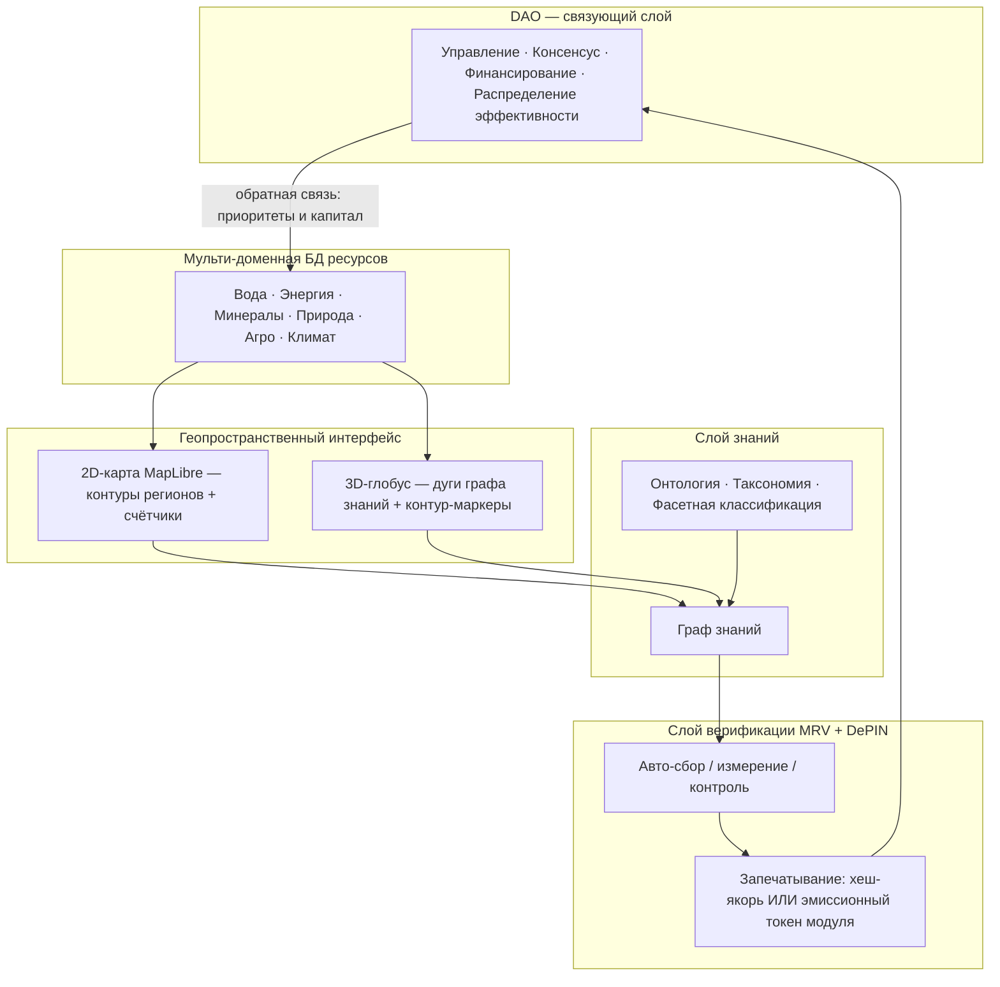
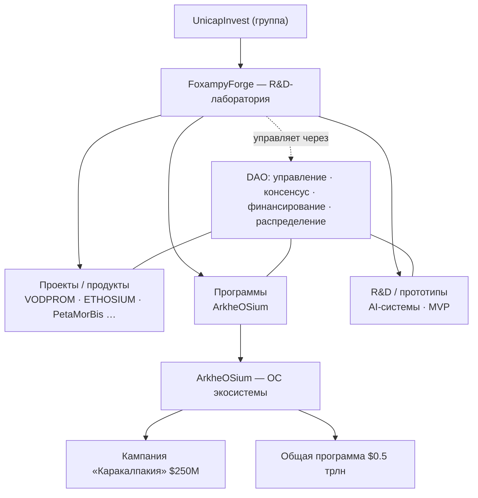
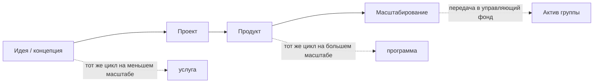
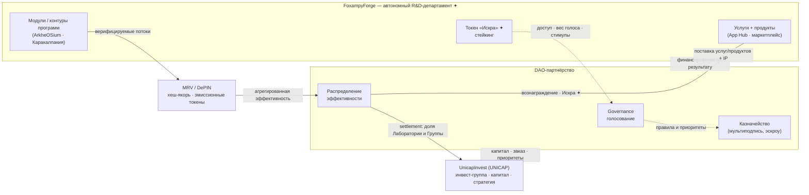
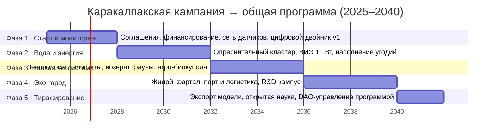

# ArkheOSium — ПОЛНЫЙ единый документ

> Один файл, объединяющий всё: канонические факты, граф связей и полный текст всех документов (Экосистема, Лаборатория FoxampyForge, DAO-партнёрство с UnicapInvest, дорожная карта, Программа «Аральское море»). Предназначен для полного разбора и изучения.

_Состав: 5 документов · 54 секций · ~9914 слов · граф 43 узлов / 66 связей._

---

## ЧАСТЬ 0. Канонические факты (единый источник истины)

**Сущности**
- **ArkheOSium** — Операционная система (ОС) экосистемы ресурсов и жизни планеты; мульти-доменная платформа: 2D-карта + 3D-глобус, граф знаний, MRV/DePIN-верификация.
- **FoxampyForge** — Исследовательско-инновационная (R&D) лаборатория — подразделение группы UnicapInvest; разрабатывает и управляет ArkheOSium и проектами через DAO.
- **UnicapInvest** — Материнская инвестиционная группа (UNICAP); Лаборатория входит в неё как автономный R&D-департамент.

**Экономика**
- $250 млн — стоимость кампании «Каракалпакия» (региональный эталон).
- $0,5 трлн — ПОЛНАЯ стоимость программы (глобальная интеграция).
- Эффект МУЛЬТИПЛИКАТИВЕН, а не аддитивен: прибыльность многократно выше даже полной кампании Каракалпакии.

**Внутренний токен** — Искра ✦: Внутренний токен Лаборатории FoxampyForge (App Hub, маркетплейс услуг, стейкинг, фрактальная методология).

**Верификация** — MRV (Measurement / Reporting / Verification) + DePIN. Каждый модуль контура автоматически собирает данные и запечатывает информацию ХЭШЕМ либо выпускает её как ЭМИССИОННЫЙ ТОКЕН, эмитируемый самим модулем.

**Слой знаний** — Онтологическая систематизация: Граф знаний поверх таксономии и фасетной классификации; DAO обеспечивает связную системность знаний, продуктов и библиотек по доменам/векторам.

---

## ЧАСТЬ 1. Граф связей (все связи текстом)

Формат: `источник — [связь] → цель`.

- FoxampyForge — [разрабатывает] → ArkheOSium
- FoxampyForge — [R&D-департамент] → UnicapInvest
- FoxampyForge — [DAO-партнёрство] → UnicapInvest
- ArkheOSium — операционная система экосистемы ресурсов и жизни планеты — [описывает] → ArkheOSium
- FoxampyForge — исследовательско-инновационная лаборатория экосистемы — [описывает] → FoxampyForge
- Лаборатория FoxampyForge × UnicapInvest: автономный R&D-департамент и DAO-партнёрство — [описывает] → FoxampyForge
- Лаборатория FoxampyForge × UnicapInvest: автономный R&D-департамент и DAO-партнёрство — [описывает] → UnicapInvest
- Дорожная карта UnicapInvest × Лаборатория FoxampyForge — [фокус] → Кампания «Каракалпакия» · $250 млн
- Программа «Аральское море» — флагман экосистемы ArkheOSium — [описывает] → Программа · $0,5 трлн
- Программа «Аральское море» — флагман экосистемы ArkheOSium — [описывает] → Кампания «Каракалпакия» · $250 млн
- Программа «Аральское море» — флагман экосистемы ArkheOSium — [ссылается] → ArkheOSium — операционная система экосистемы ресурсов и жизни планеты
- Программа «Аральское море» — флагман экосистемы ArkheOSium — [ссылается] → FoxampyForge — исследовательско-инновационная лаборатория экосистемы
- Программа «Аральское море» — флагман экосистемы ArkheOSium — [ссылается] → Лаборатория FoxampyForge × UnicapInvest: автономный R&D-департамент и DAO-партнёрство
- Программа «Аральское море» — флагман экосистемы ArkheOSium — [ссылается] → Дорожная карта UnicapInvest × Лаборатория FoxampyForge
- Кампания «Каракалпакия» · $250 млн — [×] → Мультипликативный эффект
- Мультипликативный эффект — [→ программа] → Программа · $0,5 трлн
- ArkheOSium — [флагман: Аральское море] → Программа · $0,5 трлн
- Кампания «Каракалпакия» · $250 млн — [содержит] → Вода и опреснение
- Вода и опреснение — [вектор] → Инженерный
- Кампания «Каракалпакия» · $250 млн — [содержит] → Солнце + ветер + накопители
- Солнце + ветер + накопители — [вектор] → Инженерный
- Кампания «Каракалпакия» · $250 млн — [содержит] → Агро-биокупола
- Агро-биокупола — [вектор] → Экономический
- Кампания «Каракалпакия» · $250 млн — [содержит] → Эко-город
- Эко-город — [вектор] → Социальный
- Кампания «Каракалпакия» · $250 млн — [содержит] → Логистика и порт
- Логистика и порт — [вектор] → Экономический
- Кампания «Каракалпакия» · $250 млн — [содержит] → R&D-кампус
- R&D-кампус — [вектор] → Научно-исследовательский
- Кампания «Каракалпакия» · $250 млн — [содержит] → Сеть мониторинга
- Сеть мониторинга — [вектор] → Инженерный
- Инженерная библиотека — [узел онтологии] → Онтологическая систематизация
- Научно-исследовательская — [узел онтологии] → Онтологическая систематизация
- Библиотека воды — [узел онтологии] → Онтологическая систематизация
- Энергетическая — [узел онтологии] → Онтологическая систематизация
- Агро-биологическая — [узел онтологии] → Онтологическая систематизация
- Экологическая — [узел онтологии] → Онтологическая систематизация
- Социально-правовая — [узел онтологии] → Онтологическая систематизация
- Инженерная библиотека — [связь знаний] → Научно-исследовательская
- Инженерная библиотека — [связь знаний] → Библиотека воды
- Инженерная библиотека — [связь знаний] → Энергетическая
- Научно-исследовательская — [связь знаний] → Экологическая
- Библиотека воды — [связь знаний] → Агро-биологическая
- Энергетическая — [связь знаний] → Агро-биологическая
- Экологическая — [связь знаний] → Социально-правовая
- Научно-исследовательская — [связь знаний] → Библиотека воды
- Вода и опреснение — [эмитирует] → Счётчики воды
- Счётчики воды — [хеш] → MRV + DePIN
- Солнце + ветер + накопители — [эмитирует] → Энергетический оракул
- Энергетический оракул — [токен] → MRV + DePIN
- Агро-биокупола — [эмитирует] → Агро-телеметрия
- Агро-телеметрия — [хеш] → MRV + DePIN
- Сеть мониторинга — [эмитирует] → Экологический MRV
- Экологический MRV — [токен] → MRV + DePIN
- Логистика и порт — [эмитирует] → Логистический реестр
- Логистический реестр — [хеш] → MRV + DePIN
- Сеть мониторинга — [эмитирует] → Контроллер микрогрида
- Контроллер микрогрида — [токен] → MRV + DePIN
- Управление — [функция] → DAO
- Консенсус — [функция] → DAO
- Финансирование — [функция] → DAO
- Распределение эффективности — [функция] → DAO
- DAO — [управляет] → Кампания «Каракалпакия» · $250 млн
- DAO — [агрегирует] → MRV + DePIN
- DAO — [связная системность] → Онтологическая систематизация
- FoxampyForge — [управляет через] → DAO

---

## ЧАСТЬ 2. Документы

1. **ArkheOSium — операционная система экосистемы ресурсов и жизни планеты**
2. **FoxampyForge — исследовательско-инновационная лаборатория экосистемы**
3. **Лаборатория FoxampyForge × UnicapInvest: автономный R&D-департамент и DAO-партнёрство**
4. **Дорожная карта UnicapInvest × Лаборатория FoxampyForge**
5. **Программа «Аральское море» — флагман экосистемы ArkheOSium**

---

# Документ 01. ArkheOSium — операционная система экосистемы ресурсов и жизни планеты

> Технико-экономический документ (whitepaper) для инвесторов и партнёров.
> Версия 1.1 · Флагман: Проект «Аральское море» · Продакшн: `arkheosium.vercel.app`

---

## 1. Аннотация / резюме

**ArkheOSium** — это операционная система (ОС) для экосистемы ресурсов и жизни человечества, планеты и цивилизации. Как классическая ОС управляет ресурсами компьютера, ArkheOSium управляет ресурсами Земли: водой, энергией, минералами, природой, сельским хозяйством и климатом — сводя разрозненные данные, знания, инженерию и капитал в единый управляемый контур.

Технологически ArkheOSium — это реально работающее веб-приложение (React + TypeScript + Vite), развёрнутое на Vercel. Оно объединяет пять слоёв: **мульти-доменную базу данных ресурсов**, **двойной геопространственный интерфейс** (2D-карта + 3D-глобус), **слой знаний** (граф знаний поверх онтологии), **слой верификации** (MRV + DePIN с криптографическим запечатыванием данных) и **DAO** как связующий слой управления и финансирования.

ArkheOSium задумана не как набор веб-страниц, а как **цифровая операционная среда всей Инновационной лаборатории**: люди работают не «в приложении», а внутри Лаборатории, используя ArkheOSium как единую среду управления исследованиями, проектами, продуктами, знаниями, партнёрствами и капиталом. Лаборатория **FoxampyForge** при этом одновременно **работает внутри этой среды и создаёт/развивает** саму ОС; весь проект **принадлежит Лаборатории**, тогда как управление ведётся **через DAO**. Пользователь всегда находится внутри одного живого пространства, а меняется лишь уровень погружения и активный контекст — по принципу **Environment → Workspace → Object → Context → Action**.

**Для кого этот документ:** инвесторы, институциональные партнёры, правительства регионов и научные консорциумы, которым нужна прозрачная, верифицируемая и тиражируемая модель управления ресурсами. Флагманская витрина ОС — **Проект «Аральское море»**: региональная кампания «Каракалпакия» стоимостью **$250 млн** служит самодостаточным эталоном, а общая программа Проекта оценивается в **$0.5 трлн** с мультипликативной — а не аддитивной — рентабельностью и готовностью к развёртыванию в любом регионе Земли и за её пределами.

---

## 2. Проблема: ресурсы и жизнь планеты под давлением

Деградация экосистем — не абстракция, а измеримый системный сбой. Ключевой ресурс — **вода**: от неё зависят энергетика, сельское хозяйство, здоровье населения и климатическая стабильность. Разрушение водного баланса запускает каскад: пересыхание водоёмов → пыльные бури и засоление почв → потеря биоразнообразия → социальная и экономическая деградация региона.

Аральское море — хрестоматийный пример этого каскада: одно из крупнейших внутренних морей планеты сократилось до фрагментов, оставив десятки тысяч квадратных километров токсичной пустыни Аралкум и поставив под угрозу миллионы людей в южном Приаралье.

Корневая проблема — **фрагментарность управления**. Данные о ресурсах разрознены, знания заперты в отраслевых силосах, инвестиции идут «по обещаниям», а результаты не поддаются независимой проверке. Каждый вектор (вода, энергия, экология, наука, экономика, социум) оптимизируется отдельно — и суммарный эффект оказывается ниже потенциала. Требуется **системная интеграция**, в которой измерение, знание, инженерия и капитал работают как единый организм.

---

## 3. Видение и миссия

**Видение:** единый путь к всеобщему процветанию через модульные системы и кампании, связывающие все векторы — экологию, знания/R&D, экономику, науку и социальные программы. Процветание достижимо только при прямой интеграции всех проектов и кампаний — и именно это реализует Проект «Аральское море» как первая витрина ОС.

**Миссия ArkheOSium** — быть «операционной системой экосистемы ресурсов и жизни»: слоем, который делает состояние планетарных ресурсов наблюдаемым, знание — связным, результат — верифицируемым, а капитал — направляемым по доказанной эффективности. ОС не заменяет исполнителей на местах — она даёт им общую среду, стандарт данных и механизм консенсуса, позволяющий тиражировать успешную региональную кампанию по всей Земле и за её пределами (колонизация, новые сферы интегрирования).

---

## 4. Архитектура ОС

ArkheOSium построена из пяти взаимосвязанных слоёв. Нижние слои поставляют данные и факты, верхние — смысл и управление.

- **Слой 1 — мульти-доменная БД ресурсов.** Единая база объектов и субъектов по шести доменам с канонической палитрой (см. раздел 6). Каждый объект привязан к территории, домену и вектору.
- **Слой 2 — двойной геопространственный интерфейс.** *2D-карта* (`src/components/map/WaterMap.tsx`) на MapLibre рисует контуры регионов по заданным территориальным границам с табличкой «название + количество объектов», группируя объекты по уровню зума. *3D-глобус* (`src/pages/EarthGlobePage.tsx`) на react-three-fiber показывает дуги графа знаний и контур-маркеры регионов, раскрывая отдельные метки при приближении.
- **Слой 3 — граф знаний.** Онтологическая систематизация связывает модули и библиотеки по каждому вектору (инженерия, наука/R&D, экономика, экология, социум).
- **Слой 4 — верификация (MRV + DePIN).** Продукты автоматически собирают, измеряют и контролируют данные и немедленно запечатывают их — хешем или эмиссионным токеном самого модуля контура.
- **Слой 5 — DAO.** Связующий слой управления, консенсуса, финансирования и распределения эффективности между модулями.

Контуры задаются на всех уровнях иерархии: **регион → кампания → модуль → вектор → общая программа**.

---

## 5. Операционная среда: онбординг, кластеры, модули

Поверх пяти технических слоёв ArkheOSium разворачивается как **единая операционная среда инноваций (Innovation Operating System)** — не сайт со страницами, а цифровой двойник всей Инновационной лаборатории, где люди, идеи, процессы, продукты, исследования и партнёрства отображаются как единый живой организм. Именно это отличает ОС от инструментов вроде Notion, Jira или Confluence: те управляют отдельными сущностями, а ArkheOSium визуализирует и сопровождает всю организацию как динамическую систему.

Среда устроена в четыре уровня погружения: **Onboarding → Living Ecosystem → Workspaces → Objects**.

**Онбординг** — короткое (5–15 минут) знакомство, а не регистрация: живое ядро собирается из частиц, раскрывается в исследования, проекты, людей, компании, AI, документы и DAO, после чего пользователь выбирает **роль** (исследователь, партнёр, компания, инвестор, разработчик, эксперт, студент, государство) и **интересы** (вода, экология, AI, архитектура, блокчейн, дизайн, smart city и др.). Роль полностью меняет дальнейший UX, а созданный цифровой профиль-аватар вводит пользователя в ОС.

**Living Ecosystem** — главный экран вместо привычной домашней страницы: в центре живое ядро **Living Core**, отражающее текущее состояние всей экосистемы, от которого расходятся связи к проектам, лабораториям, компаниям, документам, AI, DAO, людям и технологиям. Навигация строится не через меню, а через **живой граф знаний** и **универсальную командную строку** (по образцу VS Code / Obsidian): ввод запроса мгновенно перестраивает пространство вокруг нужного объекта.

**Модель живых кластеров** заменяет дерево департаментов: Innovation Core, Research, Engineering, Design, Product, Startup, Project, Knowledge, Partnership, Investment, Education, Operations. Кластер — не кнопка, а полноценное цифровое пространство, которое при приближении трансформируется в рабочую область (например, «Проекты» → портфель → конкретный проект → его задачи, документы, граф зависимостей, участники и аналитика) без выхода из системы.

**Модульная архитектура.** ОС состоит из ~18 базовых модулей, каждый существует одновременно как самостоятельное рабочее пространство и как объект в общем графе:

| Модуль | Назначение |
|---|---|
| Living Core | Центральное ядро состояния экосистемы |
| Laboratory | Лаборатория, кластеры, департаменты, исследования |
| Projects | Все проекты и их жизненный цикл |
| Products | Продукты, технологии, сервисы |
| Startups | Инкубатор и акселератор стартапов |
| Organizations | UnicapInvest, партнёры, университеты, органы власти |
| Collaborations | Совместные программы, консорциумы, DAO-группы |
| Knowledge Graph | Семантический граф знаний |
| Documents | Whitepaper, стандарты, исследования, регламенты |
| AI Workspace | Специализированные ИИ-агенты |
| Goals & OKR | Стратегия, цели, KPI, ключевые результаты |
| Roadmaps | Дорожные карты, этапы, зависимости |
| Tasks | Задачи, спринты, Kanban, Gantt |
| Grants & Funding | Гранты, инвестиции, заявки, доноры |
| Analytics | Метрики, BI, прогнозы, влияние проектов |
| Community | Эксперты, команды, коммуникации, события |
| Resources | Финансы, оборудование, интеллектуальные активы |
| Settings & Identity | Профиль, роли, права доступа, персонализация |

**Единая система объектов.** Любой объект ОС — проект, компания, документ, человек, партнёр, технология — имеет одинаковую структуру: обложка → описание → связи → документы → AI → история → комментарии → метрики → действия. Переходы реализуются не как исчезновение страниц, а как масштабирование и трансформация: контекст не теряется.

**AI Workspace** — не чат, а среда из нескольких специализированных агентов (Architect, Researcher, Lawyer, Engineer, Designer, Analyst, Grant Writer, Investor), которые «знают» всю экосистему: могут показать связи между проектами (например, как связаны Aral Nexus и VOD.eco), перестроить карту под запрос или собрать все проекты по направлению.

**Слой экосистемы (Ecosystem).** Внутри ОС проекты и направления существуют как связанные узлы единой экосистемы: **Aral Nexus**, **VOD.eco**, **Ethosium**, **Innovation Lab**, **AI**, **Education**, **DAO**. Каждый крупный проект (например, Aral Nexus) раскрывается как собственная мини-ОС: Overview, Modules, Research, Timeline, Funding, Partners, Documents, Simulation, Roadmap.

Такой подход превращает ОС из презентации в рабочую платформу: по мере роста экосистемы не требуется менять структуру — достаточно добавлять новые модули, узлы и связи.

---

## 6. Модули и векторы

ОС организует деятельность по **пяти векторам** и **шести ресурсным доменам** с канонической цветовой палитрой (синхронизирована во всём приложении):

| Домен | Цвет (hex) | Роль |
|---|---|---|
| Вода | `#00e6c8` | Ключевой ресурс — опреснение, гидробаланс, рекуперация |
| Энергия | `#f59e0b` | ВИЭ, накопители, зелёный водород |
| Минералы | `#c084fc` | Экспорт из рассола, логистика |
| Природа | `#34d399` | Восстановление экосистем, биоразнообразие |
| Агро | `#a3e635` | Биокупола, солеустойчивые культуры |
| Климат | `#7dd3fc` | Мониторинг, климат-моделирование |

**Векторы:** научно-исследовательский, экономический, инженерный, экологический, социальный. Реальные модули кампании «Каракалпакия» (из `src/data/karakalpak-campaign.ts`):

| Модуль | Вектор | Домен | Назначение | Метрика |
|---|---|---|---|---|
| Вода и опреснение | Инженерный | Вода | Солнечное опреснение и рециркуляция | 480 000 м³/сут |
| Солнце + ветер + накопители | Инженерный | Энергия | Гибридное поле ВИЭ + зелёный водород | 3,2 ГВт |
| Агро-биокупола | Экономический | Агро | Вертикальные фермы, аквапоника, галофиты | 120 га |
| Эко-город | Социальный | Природа | Биоклиматический «15-минутный город» | 45 000 жителей |
| Логистика и порт | Экономический | Минералы | Мультимодальный узел, экспорт минералов | 2,4 млн т/год |
| R&D-кампус | Научно-исслед. | Климат | Открытая наука, полигон прототипов | 1 200 исследователей |
| Сеть мониторинга | Инженерный | Климат | Цифровой двойник + поток верифицируемых данных | 52 000 датчиков |

Каждый модуль подключён к DAO и к потоку верифицируемых данных, а его эффект по вектору агрегируется в общую эффективность программы.

---

## 7. Слой знаний: онтологическая систематизация

Знания ArkheOSium систематизированы научно корректным образом — как **онтологическая систематизация**, реализованная в виде **графа знаний (knowledge graph)** поверх **таксономии** и **фасетной классификации**.

- **Онтология** — формальное машиночитаемое представление области: сущности, свойства и связи, обеспечивающее интеграцию между векторами.
- **Граф знаний** — узлы (библиотеки/модули) и рёбра (семантические связи); дуги графа уже визуализируются на 3D-глобусе.
- **Таксономия** — иерархия «вектор → модуль → задача».
- **Фасетная классификация** — классификация по нескольким независимым фасетам одновременно (например: технология · TRL · модуль).

**Библиотеки знаний** — узлы онтологии, собственные и партнёрские, по областям каждого вектора:

| Библиотека | Домен | Тип | Фасет |
|---|---|---|---|
| Инженерная | Инженерия | своя | технология · TRL · модуль |
| Научно-исследовательская | Наука | своя | дисциплина · метод · датасет |
| Библиотека воды | Вода | своя | процесс · источник · качество |
| Энергетическая | Энергия | партнёр | генерация · хранение · баланс |
| Агро-биологическая | Агро | партнёр | культура · цикл · субстрат |
| Экологическая | Экология | своя | экосистема · вид · индикатор |
| Социально-правовая | Социум | партнёр | сектор · норма · практика |

Связи между библиотеками (рёбра онтологии) задают семантику интеграции: инженерия ↔ наука ↔ вода ↔ энергия ↔ агро ↔ экология ↔ социум образуют связный граф, а не набор изолированных силосов.

---

## 8. Верификация и токенизация данных (MRV + DePIN)

Доверие инвестора строится на проверяемости. ArkheOSium встраивает верификацию в саму точку измерения по стандарту **MRV** (Measurement, Reporting, Verification) на инфраструктуре **DePIN** (Decentralized Physical Infrastructure).

Продукты каждого модуля автоматически собирают, измеряют и контролируют данные и **немедленно запечатывают** их одним из двух способов:

1. **Хеш-якорь (hash-anchoring)** — измерение фиксируется криптографическим хешем on-chain как неизменяемое доказательство факта.
2. **Эмиссионный токен** — данные токенизируются **самим модулем контура** прямо в точке замера: измерение становится верифицируемым активом (`data → asset`).

| Продукт | Модуль | Печать | Что фиксирует |
|---|---|---|---|
| Счётчики воды и качества | Опреснение | Хеш-якорь | Объём и качество пресной воды |
| Энергетический оракул | Энергия | Токен эмиссии | Выработка ВИЭ |
| Агро-телеметрия | Агро | Хеш-якорь | Урожайность, расход воды и нутриентов |
| Экологический MRV | Мониторинг | Токен эмиссии | Поглощение CO₂ → углеродные токены |
| Логистический реестр | Порт | Хеш-якорь | Грузооборот, экспорт минералов |
| Контроллер микрогрида | Мониторинг | Токен эмиссии | DePIN-узлы токенизируют потоки |

Каждый контур (**регион → кампания → модуль → вектор**) эмитирует собственный верифицируемый поток. Потоки агрегируются в общую эффективность программы и поступают в DAO, где капитал направляется в модули по доказанным результатам, а не по обещаниям.

---

## 9. Экономика

Экономическая модель ArkheOSium строится на двух уровнях: региональная кампания-эталон и глобальная программа.

| Уровень | Оценка | Смысл |
|---|---|---|
| **Кампания «Каракалпакия»** | **$250 млн** | Самодостаточный региональный эталон; окупается внутри региона; все векторы в одном контуре |
| **Общая программа Проекта** | **$0.5 трлн ($500 млрд)** | Тиражирование по всем регионам Земли и за её пределами; рентабельность в разы выше |

**Ключевой тезис — мультипликативность, а не аддитивность.** Общая программа стоит и приносит больше суммы отдельных кампаний, потому что интеграция всех векторов даёт **системный множитель**. Кампания «Каракалпакия» рентабельна сама по себе; общая программа — мультипликативно рентабельнее за счёт совместной работы всех модулей, систем и кампаний как единого организма.

Эффекты кампании по векторам (агрегируются в общую эффективность):

| Вектор | Эффект | Показатель |
|---|---|---|
| Научно-исследовательский | Открытая наука и полигон технологий | ~85 патентов/год |
| Экономический | Самоокупаемый региональный контур | 28 000 рабочих мест |
| Инженерный | Цифровой двойник и автоматизация | 52 000 датчиков в сети |
| Экологический | Восстановление экосистемы | 18 000 га восстановлено |
| Социальный | Здоровье, образование, среда | ~3 млн человек под влиянием |

Модель тиражируема: та же архитектура кампании разворачивается в любом регионе — «где бы мы ни были», включая колонизацию других планет и новые сферы интегрирования.

---

## 10. Флагман: Проект «Аральское море» как витрина ОС

Проект «Аральское море» — первая полная демонстрация всех пяти слоёв ОС в действии, поданная как иммерсивная презентация.

**Маршрут витрины `/journey → /aral`:**

1. **`/journey`** (`src/pages/EcoJourneyPage.tsx`) — онбординг-таймлапс истории планетарной воды (−10 000 лет → 2026 → +100 лет наблюдаемого будущего) вокруг «чистого» глобуса: ледники, реки, ирригация, усыхание Арала, дефицит, «угасание».
2. **Возврат в настоящее** — раскрываются метки как контуры регионов с табличками; пульсирует Средняя Азия; центрирование на Аральском море → попап «Проект Аральское море».
3. **`/aral`** (`src/pages/AralSeaProjectPage.tsx`) — split-раскладка: sticky-карта Центральной Азии (левая половина / верх на мобильном) + скролл-главы справа. Карта авто-зумит области под активную главу (`IntersectionObserver` → `flyTo`).
4. **Выбор программы** (`src/components/eco/DualProgramStage.tsx`) — любой путь раскрывает параллельный split «общая программа $0.5 трлн × кампания $250 млн» со знаком «×» и плашкой мультипликативности.
5. **Каракалпакский deep-dive** (`src/components/eco/KarakalpakCampaign.tsx`) — экономика → эффекты по 5 векторам → модули → граф знаний библиотек → DAO → продукты MRV/DePIN.

Мастерплан включает зоны: жилой эко-квартал, опреснение и вода, возобновляемая энергетика, агро-биокупола, логистика/порт, R&D-кампус — с восстановлением береговой линии, водно-болотных угодий и лесополос против пыльных бурь. Обзор остальных кампаний добавляет город-остров в центре восстановленного моря и переброс паводковых вод из Сибири.

Флагман доказывает главный тезис ОС: только прямая интеграция всех векторов и контуров ведёт к процветанию.

---

## 11. Дорожная карта

Кратко (детальная версия — в отдельном документе `04-roadmap-unicap-lab-karakalpak.md`):

- **Этап 1 — Витрина и эталон.** Полный запуск презентации `/journey → /aral`, кампания «Каракалпакия» как самодостаточный референс. *(в основном реализовано)*
- **Этап 2 — Верификационный контур.** Промышленное развёртывание сети MRV/DePIN, on-chain хеш-якорение и эмиссионные токены модулей.
- **Этап 3 — DAO и капитал.** Полноценный DAO-слой: голосование за приоритеты, финансирование по верифицируемым результатам, распределение эффективности.
- **Этап 4 — Тиражирование.** Развёртывание кампаний по регионам Земли; подключение партнёрских библиотек знаний.
- **Этап 5 — За пределами Земли.** Новые сферы интегрирования и колонизация как продолжение модели.

---

## 12. Заключение

ArkheOSium превращает управление ресурсами и жизнью планеты из набора разрозненных отраслевых усилий в единую операционную систему: наблюдаемую (2D-карта + 3D-глобус), связную (граф знаний поверх онтологии), проверяемую (MRV + DePIN с хеш-якорением и токенами модулей) и управляемую по доказанной эффективности (DAO). Кампания «Каракалпакия» ($250 млн) доказывает жизнеспособность модели на одном регионе; общая программа ($0.5 трлн) раскрывает её мультипликативную ценность при интеграции всех векторов и готовность к тиражированию по всей Земле и за её пределами.

Для инвестора и партнёра это означает три вещи: **прозрачность** (каждый факт запечатан и проверяем), **тиражируемость** (эталонная кампания как рабочий шаблон) и **мультипликативную отдачу** (интеграция даёт системный множитель, а не арифметическую сумму). Проект «Аральское море» — не обещание, а работающая витрина этой операционной системы.

---

# Документ 02. FoxampyForge — исследовательско-инновационная лаборатория экосистемы

> **Из идеи и концепции — в проект и продукт.** Экосистема проектов, услуг и инвестиций.

---

## 1. Аннотация

**FoxampyForge** (далее — Лаборатория) — это исследовательское и инновационное подразделение международной инвестиционной группы **UnicapInvest**. Лаборатория превращает сырые идеи и концепции в работающие цифровые продукты, платформы и целые программы, а затем — в управляемые активы и инвестиционные инициативы.

В отличие от классического продуктового агентства, FoxampyForge устроена как **OS-подобный стартап-хаб**: у неё есть каталог приложений-продуктов (**App Hub**), маркетплейс услуг, внутренний аккаунт с кошельком и токеном **«Искра» (✦)**, стейкинг и поток заказа услуг. Всё это работает поверх единой методологической и управленческой основы — **фрактальной методологии** полного цикла разработки и **DAO** как связующего слоя управления, консенсуса, финансирования и распределения эффективности.

Флагманский проект Лаборатории — **ArkheOSium**, операционная система для экосистемы ресурсов и жизни. Лаборатория **одновременно работает внутри ArkheOSium и создаёт/развивает** её: она живёт в среде ОС и является её разработчиком. Весь проект (ArkheOSium и его экосистема) **принадлежит Лаборатории**, но управление ведётся **через DAO**. В контуре ОС разворачивается **кампания «Каракалпакия»** ($250 млн) как эталонный региональный модуль внутри **общей программы Проекта на $0,5 трлн**.

Настоящий документ описывает роль Лаборатории, её экономику, DAO, связь с ArkheOSium и портфель направлений. Место FoxampyForge внутри группы UnicapInvest подробно раскрыто в документе **03**.

---

## 2. Позиционирование: R&D-подразделение группы UnicapInvest

Согласно собственному описанию, FoxampyForge — это «сайт исследовательского / инновационного подразделения группы **UnicapInvest**». Формулировка в материалах группы: *«FoxampyForge — департамент исследований и инновационных разработок… исследовательский контур группы UnicapInvest: изучаем новые рынки и технологии, проектируем цифровые продукты и платформенные решения и доводим их до стадии передачи в управляющий фонд для масштабирования»*.

UnicapInvest — международная инвестиционная группа, управляющая капиталом и портфелем активов в реальных секторах экономики:

| Метрика группы | Значение |
|---|---|
| Под управлением | €200M |
| Портфель активов | €1.7B |
| Офисов | 8 |

Группа работает в секторах: **здравоохранение, промышленность, энергетика, инфраструктура, жильё**. Флагманская инициатива группы — **VODPROM** (цифровая платформа управления водными и земельными ресурсами, в контуре которой — Token Vodprom и партнёрство Culligan).

Роль FoxampyForge в этой конструкции однозначна: это **инновационный двигатель группы**. Лаборатория ведёт разведку рынков и технологий, собирает продукты «из идеи в продукт» и передаёт зрелые решения в управляющий фонд для масштабирования. Девиз группы, который наследует и Лаборатория: *«Цена величия — ответственность»*.

---

## 3. Что Лаборатория создаёт и чем управляет

FoxampyForge одновременно **создаёт** и **управляет** тремя классами сущностей — проектами, программами и R&D-инициативами:

- **Проекты (продукты).** Портфель приложений-продуктов, каждое в активной разработке и открытое для инвестиций и стейкинга: **VODPROM** (флагман, платформа водных/земельных ресурсов), **ETHOSIUM** (цифровая ОС личности), **PetaMorBis** (цифровой зоополис), **EthosLife** (привычки и цели), **FlowBook** (поток заметок и знаний), **CreamSale** (витрина и продажи).
- **Программы.** Долгосрочные многомодульные инициативы. Флагман — **ArkheOSium** и её экологическая программа «Путь к всеобщему процветанию», внутри которой живёт кампания «Каракалпакия».
- **R&D.** Прикладные исследования и прототипы: внутренние AI-системы, экспериментальные MVP, закрытый стейкинг-пул как приватная инвестиционная инициатива.

Управление всем этим портфелем — не ручное, а системное: приоритеты, финансирование и распределение эффективности проходят через **DAO Лаборатории** (раздел 6).

---

## 4. Модель «из идеи в продукт»: фрактальная методология

Ядро Лаборатории — **фрактальная методология**: одна и та же логика полного цикла повторяется на каждом масштабе — от отдельной услуги до целой программы. В визуальном языке сайта Лаборатории это выражено мотивом «живой материи»: WebGL-фон «песка времени», поверх которого лежат «высеченные в камне плиты» — метафора решений, обретающих постоянство и вес.

Полный цикл проходит **8 стадий**:

| # | Стадия | Суть |
|---|---|---|
| 1 | Исследование | Рынок, пользователи, технологии → карта возможностей и гипотезы. |
| 2 | Стратегия | Бизнес-модель, приоритеты, дорожная карта, критерии успеха. |
| 3 | Систематизация | Данные, процессы и требования сводятся в единую логику. |
| 4 | Архитектура | Сущности, связи, потоки данных, техническая основа под нагрузку. |
| 5 | Брендирование | Позиционирование, вербальная и визуальная идентичность. |
| 6 | Дизайн | UX/UI и дизайн-система, готовая к разработке. |
| 7 | Разработка | Инженерия, выдерживающая нагрузку; AI/автоматизация как инструмент. |
| 8 | Рост | Запуск, аналитика, масштабирование, передача в управляющий фонд. |

«Фрактальность» означает, что этот цикл — самоподобен: услуга проходит его в миниатюре, продукт — целиком, программа — как совокупность вложенных циклов модулей. Так идея масштабируется без потери связности:

Форматы работы, в которых цикл предлагается рынку: **отдельные услуги** (один этап цикла), **полный цикл** (сквозная разработка под ключ) и **Venture Builder** (совместное создание продукта как долгосрочное партнёрство).

---

## 5. Внутренняя экономика Лаборатории

FoxampyForge реализована как OS-подобный хаб с собственной внутренней экономикой. Ключевые контуры:

- **App Hub** — каталог приложений-продуктов Лаборатории. Каждый продукт представлен карточкой со стадией готовности, направлением и открытостью к инвестициям/стейкингу.
- **Маркетплейс услуг** — таксономия услуг по направлениям (исследования, стратегия, брендинг, AI, инженерия и др.) с потоком заказа услуги.
- **Аккаунт и кошелёк** — личный контур пользователя с внутренним токеном **«Искра» (✦)**.
- **Стейкинг** — механика удержания/участия; в портфеле есть и **закрытый стейкинг-пул** как отдельная приватная инициатива.
- **Поток заказа услуг** — сквозной сценарий: вход → выбор услуги/продукта → оформление заявки.

Токен **«Искра» (✦)** — внутренняя единица ценности хаба: он связывает потребление услуг, участие в продуктах и стейкинг в единый экономический контур. Экономика построена на премиальном liquid-glass интерфейсе и подаётся как **экосистема проектов, услуг и инвестиций**, а не как разрозненный набор функций.

> **Дисклеймер.** Инвестиционно-стейкинговые разделы Лаборатории носят информационный характер и не являются инвестиционной рекомендацией или обещанием доходности.

---

## 6. DAO Лаборатории

Управление портфелем проектов, программ и R&D осуществляется через **DAO** — связующий слой системности и интеграции. DAO решает четыре задачи:

| Функция | Что делает |
|---|---|
| **Управление** | Держатели голосуют за приоритеты модулей и распределение ресурсов. |
| **Консенсус** | Решения фиксируются on-chain — прозрачно и невозвратно для всех контуров. |
| **Финансирование** | Пул капитала направляется в модули **по верифицируемым результатам, а не по обещаниям**. |
| **Распределение эффективности** | Эффект каждого модуля агрегируется и справедливо распределяется между участниками и командами. |

Принцип «финансирование по верифицируемым результатам» — центральный. DAO не раздаёт капитал под декларации: каждый модуль (проект, команда, контур) поставляет **верифицируемый поток данных** (см. раздел 7), из которого складывается его измеримая эффективность. Именно эта эффективность агрегируется и становится основанием для распределения ресурсов и вознаграждения. Так DAO превращает разрозненные команды в единый организм, где вклад каждого измерим и справедливо учтён.

---

## 7. Связь с ArkheOSium: граф знаний, MRV/DePIN, токенизация

**ArkheOSium** — флагманская программа Лаборатории и одновременно её «производственная площадка», на которой инструменты FoxampyForge проявляются в продукте. Более того, ArkheOSium служит **цифровой операционной средой самой Лаборатории**: команды работают не «в приложении», а внутри Лаборатории, используя ОС как единое пространство управления исследованиями, проектами, знаниями и партнёрствами (онбординг, живые кластеры, граф знаний, AI-агенты). Детальная архитектура этой среды раскрыта в документе **01**. Ключевые инструменты связи:

**Граф знаний и онтология.** Знания каждого вектора хранятся как **библиотеки знаний** (собственные + партнёрские), связанные в **онтологический граф знаний (knowledge graph)** над **таксономией** и **фасетной классификацией**. Онтология — это формальное, машиночитаемое представление области: сущности, свойства и связи, обеспечивающее интеграцию между доменами. Библиотеки — узлы графа; связи между ними задают семантику интеграции модулей.

| Библиотека | Домен | Тип |
|---|---|---|
| Инженерная | Инженерия | своя |
| Научно-исследовательская | Наука | своя |
| Библиотека воды | Вода | своя |
| Энергетическая | Энергия | партнёрская |
| Агро-биологическая | Агро | партнёрская |
| Экологическая | Экология | своя |
| Социально-правовая | Социум | партнёрская |

**MRV + DePIN.** Продукты Лаборатории автоматически **измеряют, фиксируют и верифицируют** данные каждого модуля (Measurement, Reporting, Verification) поверх децентрализованной физической инфраструктуры (DePIN). Каждое измерение сразу **запечатывается**: либо криптографическим **хешем** (неизменяемое доказательство факта), либо **токеном эмиссии самого модуля** (данные становятся верифицируемым активом прямо в точке замера).

**Токенизация.** Каждый контур — регион → кампания → модуль → вектор — эмитирует собственный верифицируемый поток. Потоки агрегируются в общую эффективность программы и в DAO. Так граф знаний, MRV/DePIN и токенизация вместе образуют замкнутую петлю: измеримое знание → верифицируемый актив → управленческое решение.

---

## 8. Портфель направлений / векторов

Лаборатория ведёт **семь направлений** («направлений» в терминах сайта Лаборатории), закрывающих полный цикл — от исследования до жизни продукта в экосистеме:

| Направление | Фокус |
|---|---|
| Инновационные исследования | Рынки, отрасли, пользователи, технологии — поиск неочевидных возможностей. |
| Бизнес-стратегия | Бизнес-модель, концепции, архитектура решений. |
| Бренд-системы | Стратегия, вербальная и визуальная идентичность, brandbook. |
| Продуктовый дизайн | UX/UI, прототипы, дизайн-системы. |
| AI и автоматизация | AI-агенты, автоматизация процессов, интеллектуальные системы. |
| Цифровая инженерия | Веб-платформы, SaaS, мобильные приложения, MVP. |
| Развитие экосистемы | Запуск, рост, интеграция в UnicapInvest, масштабирование. |

В прикладной плоскости (на примере ArkheOSium/Каракалпакии) эти направления разворачиваются в **пять векторов эффективности**: **научно-исследовательский**, **экономический**, **инженерный**, **экологический** и **социальный**. Каждый вектор наполнен конкретными модулями продуктов — от воды и опреснения, гибридной энергетики и агро-биокуполов до эко-города, логистики/порта, R&D-кампуса и сети мониторинга (52 000 датчиков). Эффект по векторам агрегируется в общую эффективность программы через DAO.

---

## 9. Как Лаборатория входит в UnicapInvest

FoxampyForge — **исследовательско-инновационный контур** группы UnicapInvest. Схема взаимодействия проста и односторонне-восходящая: Лаборатория порождает и вынашивает продукты и программы, доводит их до зрелости и **передаёт в управляющий фонд группы** для масштабирования и превращения в актив портфеля. Обратно Лаборатория получает капитал, доступ к секторам группы (здравоохранение, промышленность, энергетика, инфраструктура, жильё) и связь с флагманскими инициативами (VODPROM). Полная модель встраивания, потоки капитала и права — в документе **03**.

---

## 10. Заключение

FoxampyForge — это не студия и не фонд, а **лаборатория полного цикла**, которая соединяет три обычно разрозненных мира: создание продуктов, управление ими и их финансирование. Фрактальная методология даёт воспроизводимый путь «из идеи в продукт» на любом масштабе; внутренняя экономика (App Hub, услуги, «Искра», стейкинг) делает Лабораторию самодостаточным хабом; DAO превращает управление в прозрачную, верифицируемую и справедливую систему; а ArkheOSium — с её графом знаний, MRV/DePIN и токенизацией — служит и флагманской программой, и витриной инструментов.

Кампания «Каракалпакия» ($250 млн) как эталонный модуль внутри общей программы на $0,5 трлн показывает главный тезис Лаборатории: **эффективность интегрированной системы мультипликативна, а не аддитивна**. Именно эту мультипликативность FoxampyForge и производит — превращая идеи в продукты, продукты в программы, а программы — во всеобщее процветание.

---

# Документ 03. Лаборатория FoxampyForge × UnicapInvest: автономный R&D-департамент и DAO-партнёрство

> Whitepaper 03 — модель интеграции исследовательской лаборатории FoxampyForge в инвестиционную группу UnicapInvest: автономная работа как R&D-департамент при поставке всех услуг и продуктов через DAO-партнёрство.

---

## 1. Аннотация

Настоящий документ описывает организационно-экономическую модель, в которой **исследовательская лаборатория FoxampyForge** («Лаборатория», ✦) существует как **инновационное подразделение группы UnicapInvest** («UNICAP», «Группа»), но действует **автономно**: ведёт собственную R&D-повестку, оперирует внутренним токеном «Искра» (✦) и управляет своими проектами и программами через **DAO-механику**. Флагманский проект ArkheOSium **принадлежит Лаборатории**, которая **одновременно работает внутри его среды и создаёт/развивает** его; при этом всё управление проектом ведётся **через DAO**.

Ключевой тезис: **всё, что Лаборатория производит — услуги, продукты, интеллектуальную собственность и подтверждённую эффективность программ — она поставляет Группе (и внешним партнёрам) через DAO-партнёрство**. Поставка, расчёты, распределение ценности и подтверждение результата совершаются on-chain: смарт-контракты фиксируют услуги и продукты, а верифицируемые потоки данных программ (MRV/DePIN, хеш-якорение, эмиссионные токены модулей) агрегируются в измеримую эффективность и распределяются между Лабораторией и UnicapInvest по прозрачным правилам казначейства.

Такая конструкция соединяет две логики: **вертикальную** (Лаборатория — департамент Группы, встроенный в её стратегию и капитал) и **горизонтальную** (Лаборатория — самостоятельный участник DAO, продающий результат по факту, а не по обещанию). Эталоном служит кампания «Каракалпакия» (**$250 млн**, самодостаточна), масштабируемая до общей программы (**$0.5 трлн**, мультипликативный эффект).

---

## 2. Стороны партнёрства

| Сторона | Что это | Роль в партнёрстве |
|---|---|---|
| **UnicapInvest (UNICAP)** | Инвестиционная группа — материнская структура. Владеет капиталом, стратегией и портфелем. | **Заказчик и инвестор R&D.** Формирует стратегические приоритеты, предоставляет капитал, принимает результат (продукты, IP, эффективность) и монетизирует его на рынке. |
| **FoxampyForge (Лаборатория, ✦)** | Исследовательское/инновационное **подразделение группы UnicapInvest** (verbatim из README: «...подразделения группы UnicapInvest»). OS-подобный стартап-хаб: каталог продуктов (App Hub), маркетплейс услуг, аккаунт с кошельком, токен «Искра», стейкинг, поток заказа услуг. **Владелец проекта ArkheOSium**: одновременно работает внутри его среды и создаёт/развивает его. | **Автономный R&D-исполнитель и владелец ArkheOSium.** Превращает «идею и концепцию в проект и продукт», ведёт собственную научную повестку, управляет проектами через DAO, поставляет услуги/продукты Группе и партнёрам. |

**Разграничение ролей.** UnicapInvest отвечает на вопрос «**что** и **зачем**» на уровне стратегии и капитала; FoxampyForge отвечает на вопрос «**как**» на уровне исследований, инженерии и продукта. Связующим слоем между «зачем» Группы и «как» Лаборатории выступает DAO — именно там встречаются заказ, исполнение и расчёт.

---

## 3. Модель автономии

Автономия Лаборатории означает, что она самостоятельно управляет своим внутренним контуром, но синхронизирует стратегические и капиталоёмкие решения с Группой.

| Лаборатория решает **сама** (автономно) | Согласуется с **UnicapInvest** (совместно) |
|---|---|
| Собственная R&D-повестка: направления, приоритеты, полигоны прототипов | Стратегические приоритеты портфеля и вход в новые рынки/регионы |
| Внутренняя экономика: эмиссия и правила токена «Искра» ✦, стейкинг | Крупные капитальные транши и финансирование программ ($250M / $0.5T) |
| DAO-голосования по проектам и программам внутри Лаборатории | Условия и ставки распределения эффективности между Лабораторией и Группой |
| Выбор технологического стека, методология, состав команд-модулей | IP-политика верхнего уровня, лицензирование за пределами Группы |
| Каталог услуг и продуктов (App Hub, маркетплейс услуг) | Целевые SLA/KPI по программам, публичные обязательства Группы |

**Принцип.** Лаборатория автономна в *операциях и исследованиях*, но подотчётна Группе в *стратегии и капитале*. Автономия защищена технически: DAO-голосования и казначейство Лаборатории исполняются on-chain, а UnicapInvest участвует как крупный стейкхолдер с правом голоса, а не как ручной оператор.

---

## 4. DAO-партнёрство: как услуги и продукты поставляются через DAO

DAO — это не «надстройка», а **рельсы поставки**. Каждая услуга и каждый продукт Лаборатории оформляются, исполняются и оплачиваются через смарт-контракты. DAO выступает связующим слоем системности и интеграции: управление, консенсус, финансирование, распределение эффективности.

### 4.1. Роли и объекты

| Компонент DAO | Назначение |
|---|---|
| **Управление (governance)** | Держатели голосуют за приоритеты модулей и распределение ресурсов; UnicapInvest — крупный участник голосования. |
| **Консенсус (consensus)** | Решения фиксируются on-chain — прозрачно и невозвратно для всех контуров. |
| **Финансирование (funding)** | Пул капитала направляется в модули **по верифицируемым результатам, а не по обещаниям**. |
| **Распределение эффективности (distribution)** | Эффект каждого модуля агрегируется и справедливо распределяется между участниками. |
| **Казначейство (treasury)** | Мультиподписной пул: приём капитала от Группы, выплаты Лаборатории и модулям по достигнутым KPI. |
| **Смарт-контракты услуг/продуктов** | Оформляют заказ услуги, поставку продукта, передачу IP и триггерят расчёт по факту исполнения. |

### 4.2. Жизненный цикл поставки

1. **Заказ.** UnicapInvest (или партнёр) размещает заказ на услугу/продукт через маркетплейс Лаборатории; смарт-контракт фиксирует условия, KPI и объём эскроу.
2. **Исполнение.** Соответствующий модуль/команда Лаборатории выполняет работу; прогресс привязывается к верифицируемым потокам данных (см. §6).
3. **Верификация.** MRV/DePIN-продукты запечатывают результат хешем или эмиссионным токеном модуля — доказательство факта, а не отчёт-обещание.
4. **Расчёт.** По достижении KPI казначейство высвобождает средства и начисляет распределение эффективности между Лабораторией и Группой.
5. **Учёт IP.** Права на созданный продукт/решение фиксируются on-chain согласно IP-политике (см. §7).

---

## 5. Экономика взаимодействия

### 5.1. Токен «Искра» (✦) и стейкинг

«Искра» — **внутренний токен Лаборатории**, обслуживающий её собственный контур: доступ к услугам маркетплейса, стейкинг, стимулирование участников и вес в DAO-голосованиях по проектам Лаборатории. Это единица внутренней координации, отделённая от капитала Группы: UnicapInvest вносит капитал в казначейство DAO, тогда как «Искра» распределяет *операционную* мотивацию и права внутри Лаборатории.

**Стейкинг** выполняет двойную роль: (1) выравнивает интересы исполнителей-модулей с результатом (застейканная «Искра» «на кону» под KPI), (2) регулирует вес голоса и приоритетный доступ к заказам.

### 5.2. Связь с эмиссионными токенами модулей ArkheOSium

Помимо «Искры» как *внутренней* валюты, отдельные модули и контуры программ (ArkheOSium, кампания «Каракалпакия») эмитируют **собственные эмиссионные токены** прямо в точке измерения (например, энергетический оракул токенизирует выработку ВИЭ; экологический MRV эмитирует углеродные токены). Это разные слои:

| Слой | Токен | Что представляет | Где обращается |
|---|---|---|---|
| **Координационный** | «Искра» ✦ | Труд, доступ, права голоса внутри Лаборатории | Контур FoxampyForge |
| **Эмиссионный (модульный)** | Токены модулей/контуров | Верифицированный физический результат («данные → актив») | Программы / DAO |

Связь между слоями замыкается в казначействе DAO: эмиссионные токены модулей формируют **измеримую эффективность программы**, которая конвертируется в расчёты между Лабораторией и Группой, а часть возврата поступает исполнителям в «Искре».

### 5.3. Распределение эффективности

Эффект каждого модуля агрегируется и распределяется по правилам DAO. Финансирование идёт **по верифицируемым результатам**: чем больше подтверждённой эффективности сгенерировал контур, тем большую долю settlement он получает — и тем большую отдачу фиксирует UnicapInvest как инвестор.

---

## 6. Верификация ценности: от измерения до расчёта

Ценность в этой модели не декларируется — она **доказывается** и только затем оплачивается. Механика: **MRV + DePIN → hash-anchoring / эмиссионные токены → агрегация эффективности → settlement в DAO**.

- **MRV** (Measurement, Reporting, Verification) — измерение, отчётность, верификация.
- **DePIN** (Decentralized Physical Infrastructure) — децентрализованная физическая инфраструктура (датчики, оракулы, контроллеры микрогрида).

Каждый контур (**регион → кампания → модуль → вектор**) эмитирует собственный верифицируемый поток: измерение сразу запечатывается либо **криптографическим хешем** (неизменяемое доказательство факта), либо **эмиссионным токеном самого модуля** (данные становятся активом прямо в точке замера).

| Продукт данных | Модуль | Тип печати | Смысл |
|---|---|---|---|
| Счётчики воды и качества | Опреснение | Хеш-якорь | immutable proof объёма/качества воды |
| Энергетический оракул | ВИЭ | Токен эмиссии | data → asset: выработка как актив |
| Агро-телеметрия | Агро-биокупола | Хеш-якорь | immutable proof урожайности/расхода |
| Экологический MRV | Мониторинг | Токен эмиссии | углеродные токены (CO₂, восстановление) |
| Логистический реестр | Порт | Хеш-якорь | immutable proof грузооборота |
| Контроллер микрогрида | Мониторинг | Токен эмиссии | DePIN-узлы токенизируют потоки автономно |

**Цепочка расчёта:** потоки продуктов данных → агрегация в общую эффективность программы → правила распределения в DAO → settlement между Лабораторией (исполнитель) и UnicapInvest (инвестор). Так «отчёт» превращается в «доказательство», а «доказательство» — в «расчёт».

---

## 7. Юридически-организационный контур

Модель совмещает два статуса Лаборатории, которые не противоречат, а дополняют друг друга.

| Аспект | Как департамент UnicapInvest | Как автономная DAO-структура |
|---|---|---|
| **Статус** | Подразделение Группы, встроенное в её стратегию и отчётность | Самостоятельный участник DAO с собственным казначейством и голосом |
| **Услуги** | Внутренний R&D-сервис Группы | Поставляются через смарт-контракты маркетплейса, в т.ч. внешним партнёрам |
| **Продукты** | Пополняют портфель Группы | Оформляются и передаются on-chain по факту приёмки |
| **IP** | Верхнеуровневая IP-политика Группы | Права фиксируются on-chain; лицензирование — по правилам DAO |
| **Расчёты** | Бюджет/трансфертное ценообразование внутри Группы | Settlement по верифицированной эффективности через казначейство |

> **Модель, подлежит юридическому оформлению.** Конкретная правовая форма DAO (например, обёртка юрлица, статус токенов «Искра» и эмиссионных токенов, трансграничные аспекты, трансфертное ценообразование «департамент ↔ Группа») здесь описана на принципиальном уровне и требует отдельного юридического оформления. Приведённые механизмы задают *логику* отношений, а не готовую правовую конструкцию.

---

## 8. Управление рисками и прозрачность

| Риск | Механизм снижения |
|---|---|
| Оплата за необеспеченный результат | Финансирование только по верифицируемым результатам; эскроу до достижения KPI |
| Манипуляция данными | MRV/DePIN с хеш-якорением; данные неизменяемы после запечатывания |
| Непрозрачность решений | Все governance-решения фиксируются on-chain, невозвратно и публично аудируемо |
| Конфликт «департамент ↔ автономия» | Разграничение зон решений (§3); Группа голосует как стейкхолдер, а не оперирует вручную |
| Концентрация власти в голосовании | Веса через стейкинг «Искры»; правила кворума и распределения (подлежат настройке в DAO) |
| Правовая неопределённость | Явная маркировка «модель, подлежит юр-оформлению»; принципиальный уровень до оформления |

**Прозрачность как продукт.** Аудируемость здесь не побочный эффект, а поставляемое свойство: любая сторона может проверить цепочку «измерение → хеш/токен → агрегация → расчёт» on-chain. Это и есть основа доверия между автономной Лабораторией и инвестирующей Группой.

---

## 9. Масштабирование на другие программы и кампании

Модель спроектирована как **тиражируемый шаблон**, а не разовая договорённость.

| Уровень | Оценка | Смысл для партнёрства |
|---|---|---|
| **Кампания «Каракалпакия»** | **$250 млн** | Самодостаточный эталон: все векторы в одном контуре, каждый модуль подключён к DAO и потоку верифицируемых данных. Рабочий шаблон отношений Лаборатория ↔ Группа. |
| **Общая программа Проекта** | **$0.5 трлн** | Мультипликативный эффект: совместная работа всех модулей и кампаний как единого организма. Рентабельность **в разы выше** отдельной кампании. |

**Логика масштабирования.** Каждая новая кампания подключается к тем же рельсам: собственный DAO-контур, свои MRV/DePIN-продукты, свой поток эмиссионных токенов, агрегируемый в эффективность и settlement с Группой. Эффективность **не аддитивна, а мультипликативна** — интеграция всех векторов (экология, R&D, экономика, наука, соц. программы) даёт системный множитель. «Каракалпакия» отрабатывает шаблон; общая программа применяет его «где бы мы ни были», вплоть до новых сфер интеграции.

---

## 10. Заключение

FoxampyForge — это **автономный R&D-департамент UnicapInvest**, который поставляет Группе всё созданное — услуги, продукты, IP и подтверждённую эффективность — **через DAO-партнёрство**. Вертикальная встроенность в стратегию и капитал Группы сочетается с горизонтальной самостоятельностью Лаборатории в исследованиях и операциях, а связующим слоем выступает DAO: заказ, исполнение, верификация и расчёт совершаются on-chain.

Ключевое преимущество модели — **оплата по доказанному результату**: MRV/DePIN-потоки превращают физический эффект в неизменяемые доказательства и эмиссионные токены, те агрегируются в эффективность программы, а казначейство DAO распределяет ценность между Лабораторией и Группой. Отработанная на кампании «Каракалпакия» ($250 млн, самодостаточна), эта конструкция масштабируется до общей программы ($0.5 трлн) с мультипликативным эффектом — единый, прозрачный и тиражируемый механизм создания и распределения ценности.

> *Конкретные правовые детали DAO, статуса токенов и трансфертных расчётов приведены на принципиальном уровне и подлежат отдельному юридическому оформлению.*

---

# Документ 04. Дорожная карта UnicapInvest × Лаборатория FoxampyForge

### Совместный рабочий план по всем программам и векторам с фокусом на Каракалпакскую кампанию

> Документ уровня whitepaper / roadmap. Согласован с приложением ArkheOSium: массивом `ROADMAP` (2025→2040) и данными кампании `karakalpak-campaign.ts`. Все суммы и метрики приведены к единой канонической базе: кампания «Каракалпакия» — **$250 млн**, общая программа Проекта — **$0,5 трлн**.

---

## 1. Аннотация

Настоящая дорожная карта фиксирует **совместный рабочий план** инвестиционной группы **UnicapInvest** («UNICAP») и её автономного научно-исследовательского департамента — **Лаборатории FoxampyForge** — по всему циклу «идея → продукт → масштаб» и по всем векторам: инженерному, научно-исследовательскому, экономическому, экологическому и социальному.

UnicapInvest выступает материнской инвестиционной группой и держателем капитального контура; Лаборатория FoxampyForge **одновременно работает внутри ArkheOSium и создаёт/развивает** её — операционную систему для экосистемы ресурсов и жизни. Проект **принадлежит Лаборатории**, управление ведётся **через DAO**, а продукты и сервисы поставляются через **DAO-партнёрство**.

Немедленный фокус карты — **Каракалпакская кампания**: самодостаточный региональный эталонный модуль на **$250 млн**, отрабатывающий подход, который затем мультипликативно тиражируется в рамках общей программы на **$0,5 трлн** — по регионам Земли и за её пределами.

Адресаты документа: инвестиционный комитет UnicapInvest, руководство Лаборатории, участники DAO, региональные и научные партнёры.

---

## 2. Принципы совместной работы

1. **Лаборатория как департамент + автономия.** FoxampyForge — подразделение UnicapInvest, но с собственным R&D-контуром, бюджетом на исследования и правом на технологический риск. UNICAP задаёт инвестиционные рамки и горизонт возврата; Лаборатория отвечает за инженерию, науку и продукт.
2. **DAO-партнёрство как связующий слой.** Управление приоритетами модулей, консенсус, финансирование по результату и распределение эффективности идут через DAO. Решения фиксируются on-chain — прозрачно и невозвратно для всех контуров.
3. **Полный цикл «идея → продукт → масштаб».** Каждая инициатива проходит путь: гипотеза в Лаборатории → прототип на полигоне R&D → верифицируемый модуль в кампании → тиражируемый шаблон в общей программе.
4. **Верифицируемость по умолчанию.** Любой результат подтверждается потоком MRV/DePIN: измерение запечатывается хеш-якорем либо эмиссионным токеном самого модуля. Капитал направляется по доказанным результатам, а не по обещаниям.
5. **Мультипликативность, а не аддитивность.** Ценность программы — больше суммы кампаний: интеграция векторов даёт системный множитель.

---

## 3. Общая карта программ и векторов

Матрица «векторы × уровни контуров» связывает пять векторов с четырьмя уровнями системности: **регион → кампания → модуль → программа**.

| Вектор | Регион (южное Приаралье) | Кампания «Каракалпакия» ($250M) | Ключевой модуль | Программа ($0,5T) |
|---|---|---|---|---|
| **Инженерный** | Деградация инфраструктуры, дефицит воды | Опреснение + микрогриды + логистика | Вода/опреснение · Энергия · Сеть мониторинга | Тиражируемый инженерный шаблон «под ключ» |
| **Научно-исследовательский** | Отсутствие полигона | R&D-кампус, открытая наука | R&D-кампус (1 200 исследователей) | Глобальная открытая наука и патентный пул |
| **Экономический** | Отток населения, безработица | Замкнутая экономика, 28 000 рабочих мест | Агро-биокупола · Логистика и порт | Мультипликативная рентабельность по всем регионам |
| **Экологический** | Пыльные бури, потеря воды | Восстановление 18 000 га | Био-парк · Экологический MRV | Разворот деградации в засушливых регионах Земли |
| **Социальный** | 3 млн человек под влиянием | Эко-город, здоровье, образование | Эко-город (45 000 жителей) | Стандарт качества жизни для новых поселений |

**Сквозные слои** (действуют на всех уровнях): граф знаний / онтология (собственные + партнёрские библиотеки), DAO-управление, MRV/DePIN-верификация с хеш-якорением и эмиссионными токенами модулей.

---

## 4. Фокус сейчас — кампания «Каракалпакия»

**Цель:** превратить южное Приаралье (Каракалпакстан) в самодостаточный, самоокупаемый эталонный контур, где все пять векторов работают как единый организм, а каждый модуль подключён к DAO и потоку верифицируемых данных.

**Стоимость и самодостаточность:** **$250 млн**. Кампания окупается внутри региона — рентабельна сама по себе при интеграции всех модулей. Она служит рабочим шаблоном для тиражирования.

### 4.1. Модули кампании

| Модуль | Вектор | Назначение | Целевая метрика |
|---|---|---|---|
| **Вода и опреснение** | Инженерный | Солнечное опреснение и рециркуляция для города, агрокуполов и водоёмов | 480 000 м³/сут |
| **Солнце + ветер + накопители** | Инженерный | Гибридное поле ВИЭ + зелёный водород | 3,2 ГВт |
| **Агро-биокупола** | Экономический | Вертикальные фермы, аквапоника, галофиты | 120 га |
| **Эко-город** | Социальный | Биоклиматический «15-минутный город» | 45 000 жителей |
| **Логистика и порт** | Экономический | Мультимодальный узел, экспорт минералов из рассола | 2,4 млн т/год |
| **R&D-кампус** | Научный | Открытая наука, климат-лаборатории, полигон прототипов | 1 200 исследователей |
| **Сеть мониторинга** | Инженерный | Датчики, спутники, IoT → цифровой двойник района | 52 000 датчиков |

### 4.2. MRV/DePIN и токенизация

Каждый контур (регион → кампания → модуль → вектор) эмитирует собственный верифицируемый поток. Измерение сразу запечатывается **хеш-якорем** (неизменяемое доказательство факта) либо **токеном эмиссии** самого модуля (данные → актив прямо в точке замера). Примеры: счётчики воды и качества (хеш), энергетический оракул (токен), агро-телеметрия (хеш), экологический MRV — углеродные токены, логистический реестр (хеш), контроллер микрогрида DePIN (токен). Потоки агрегируются в общую эффективность программы и в DAO.

### 4.3. DAO-управление

DAO — связующий слой системности: **управление** (голосование за приоритеты модулей), **консенсус** (решения on-chain), **финансирование** (капитал по верифицируемым результатам), **распределение эффективности** (эффект модулей агрегируется и справедливо распределяется между участниками).

### 4.4. Граф знаний

Библиотеки семи доменов (собственные + партнёрские) — узлы **онтологической систематизации**, реализованной как граф знаний поверх таксономии и фасетной классификации. Связи между библиотеками задают семантику интеграции модулей.

---

## 5. Фазовая дорожная карта 2025 → 2040

Фазы согласованы с массивом `ROADMAP` приложения: **2025** старт/мониторинг → **2028** вода+энергия → **2032** живая экосистема → **2036** эко-город → **2040** тиражирование. Ниже — детализация по векторам, ответственным слоям, KPI/MRV и финансированию.

| Фаза / Год | Инженерный | Научный | Экономический | Экологический | Социальный | Ответственный слой | KPI / MRV | Финансирование |
|---|---|---|---|---|---|---|---|---|
| **1 · 2025** Старт и мониторинг | Сеть датчиков, цифровой двойник v1 | Базовые датасеты, методики | Соглашения и финансирование | Стабилизация грунтов (4 000 га) | Каналы вовлечения населения | UNICAP (капитал) + Лаборатория (тех.) | 5 000 датчиков; хеш-якорь замеров | Стартовый транш кампании ($250M) |
| **2 · 2028** Вода и энергия | Первый опреснительный кластер; ВИЭ 1 ГВт | Гидрология, диспетчеризация ВИЭ | Первый экспорт минералов из рассола | Наполнение угодий (1 800 га) | Доступ к чистой воде | Лаборатория + DAO (казначейство) | 150 000 м³/сут; токен энергооракула | Транш «вода+энергия» из пула DAO |
| **3 · 2032** Живая экосистема | Автоматизация агро, микрогриды | Биоинженерия, реинтродукция | Агро-биокупола, занятость | Лесополосы, галофиты (9 500 га) | Продовольственная устойчивость | Лаборатория + партнёры | 120+ видов флоры; экологический MRV-токен | Реинвест выручки + DAO |
| **4 · 2036** Эко-город | Порт, логистика, электрофлот | R&D-кампус, патенты | Грузооборот 2,4 млн т/год | Устойчивая фауна, рыбозапас ↑8x | 45 000 жителей, 28 000 рабочих мест | UNICAP + DAO | 85 патентов/год; логистический реестр (хеш) | Смешанное: выручка + внешние инвесторы |
| **5 · 2040** Тиражирование | Экспорт инженерного шаблона | Открытая наука, глобальный пул | Мультипликатор рентабельности | Разворот деградации в др. регионах | Стандарт качества жизни | DAO-управление программой | Агрегированная эффективность программы | Переход к контуру $0,5 трлн |

---

## 6. Переход от кампании к общей программе $0,5T

Каракалпакия — эталонный модуль-пример. Общая программа Проекта на **$0,5 трлн** — это **готовность разворачивать такие же кампании где угодно**: по регионам Земли (Сахель, Ближний Восток, бассейн Мёртвого моря, засушливые регионы) и за её пределами (колонизация, новые сферы интегрирования).

**Ключевой тезис ценности:** эффективность не аддитивна, а **мультипликативна**. Общая программа стоит больше суммы кампаний, потому что совместная работа всех модулей, систем и кампаний как единого организма даёт **системный множитель**. Кампания рентабельна сама по себе; программа — мультипликативно рентабельнее.

Механика тиражирования: (1) кампания отрабатывает модули и граф знаний; (2) верифицированные шаблоны через открытую науку и DAO становятся переносимыми пакетами; (3) UNICAP разворачивает капитал в новых регионах, Лаборатория адаптирует модули под локальные фасеты; (4) MRV-потоки новых кампаний вливаются в общую эффективность.

---

## 7. Модель финансирования и распределения эффективности через DAO

- **Казначейство DAO.** Пул капитала UnicapInvest + реинвест выручки кампании. Средства направляются в модули по верифицируемым результатам (MRV), а не по обещаниям.
- **Эмиссионные токены модулей.** Каждый модуль контура эмитирует токен в точке замера (энергия, CO₂, микрогрид): данные становятся верифицируемым активом. Эти токены — базовый слой распределения эффективности.
- **Стейкинг «Искра» ✦.** Держатели стейкают токен «Искра» в приоритетные модули и кампании; вознаграждение привязано к агрегированной эффективности (MRV-подтверждённой), что выравнивает интересы инвесторов, Лаборатории и региона.
- **Распределение эффективности.** Эффект каждого модуля агрегируется on-chain и справедливо распределяется между участниками DAO пропорционально вкладу и стейку.
- **Хеш-якорение отчётности.** Финансовая и результатная отчётность запечатывается хешем — прозрачно и невозвратно для инвестиционного комитета и партнёров.

---

## 8. Риски, зависимости и критерии готовности фаз (gates)

| Фаза | Ключевые риски | Зависимости | Gate (критерий перехода) |
|---|---|---|---|
| **1 · 2025** | Срыв соглашений, недофинансирование | Региональные партнёры, транш UNICAP | Подписаны соглашения; 5 000 датчиков онлайн; цифровой двойник v1 верифицирован (хеш) |
| **2 · 2028** | Технориск опреснения, дефицит ВИЭ-мощности | Гидробаланс, поставки оборудования | Опреснение ≥150 000 м³/сут; ВИЭ ≥1 ГВт; MRV-поток воды и энергии стабилен |
| **3 · 2032** | Экологическая неустойчивость посадок | Данные фазы 2, партнёрские агро-библиотеки | ≥9 500 га посадок; возврат ≥120 видов; экологический MRV-токен эмитируется |
| **4 · 2036** | Кассовые разрывы, отток населения | Выручка порта/агро, внешние инвесторы | Эко-город заселён; порт 2,4 млн т/год; R&D-кампус выдаёт патенты |
| **5 · 2040** | Разрыв шаблона при переносе | Открытая наука, зрелость DAO | Кампания самоокупаема; шаблон упакован; ≥1 новый регион в пайплайне |

Общие зависимости: зрелость DAO-казначейства, непрерывность MRV/DePIN-потоков, доступность собственных и партнёрских библиотек графа знаний.

---

## 9. Ближайшие шаги (следующие 90 дней)

1. **Соглашения и капитал.** Закрепить рамочные соглашения с регионом и утвердить стартовый транш кампании ($250M) через инвестиционный комитет UNICAP.
2. **Развернуть базовый мониторинг.** Первые ~5 000 датчиков + цифровой двойник v1; включить хеш-якорение замеров.
3. **Запустить казначейство DAO.** Настроить пул, правила финансирования по MRV, пилот стейкинга «Искра» ✦ на 2–3 приоритетных модулях.
4. **Инициализировать граф знаний.** Подключить собственные библиотеки (инженерия, наука, вода, экология) и первые партнёрские (энергия, агро, социум).
5. **Спроектировать Фазу 2.** Лаборатория готовит инженерный проект опреснительного кластера и поля ВИЭ 1 ГВт; определить gate-метрики.
6. **MRV-пилот.** Ввести в строй первые продукты авто-сбора (счётчики воды — хеш, энергооракул — токен) как доказательство концепции верификации.

---

## 10. Заключение

Дорожная карта связывает капитальный контур **UnicapInvest** и R&D-контур **Лаборатории FoxampyForge** в единый механизм полного цикла — от идеи до масштаба. Каракалпакская кампания на $250 млн — не пилот ради пилота, а **самодостаточный эталонный модуль**, который через граф знаний, DAO и MRV/DePIN превращается в переносимый шаблон общей программы на $0,5 трлн. Фазы 2025→2040 согласованы с существующим планом приложения ArkheOSium и ведут регион от мониторинга к живой экосистеме, эко-городу и — далее — к мультипликативному тиражированию по Земле и за её пределами. Возрождение начинается с одного решения; интеграция всех векторов превращает его в путь к всеобщему процветанию.

---

# Документ 05. Программа «Аральское море» — флагман экосистемы ArkheOSium

> Whitepaper 05 — комплексное описание Программы восстановления Приаралья как эталонного контура операционной системы: от региональной кампании «Каракалпакия» ($250 млн) до глобальной интеграции ($0,5 трлн). Кампании, модули, слой знаний, верификация данных и интеграции — в единой архитектуре.

---

## 1. Аннотация

**Программа «Аральское море»** — флагманская инициатива экосистемы **ArkheOSium** и предметная витрина её операционной системы. На конкретной территории южного Приаралья Программа демонстрирует полный цикл ОС: измерение состояния ресурсов, проектирование модулей, их совместную работу, верификацию результатов и справедливое распределение эффективности через DAO.

Программа устроена как **вложенная структура контуров**: регион → кампания → модуль → вектор. Нижний, полностью отработанный контур — **кампания «Каракалпакия»** стоимостью **$250 млн**, самодостаточная и рентабельная сама по себе. Верхний контур — **общая программа Проекта на $0,5 трлн**, где эффект от совместной работы всех кампаний и систем **мультипликативен, а не аддитивен**: прибыльность интегрированной программы многократно превышает сумму отдельных кампаний.

Настоящий документ описывает архитектуру Программы, её кампании, семь производственных модулей, слой знаний (онтологическая систематизация), контур верификации данных (MRV + DePIN) и способы интеграции — так, чтобы Программу можно было изучать как целостный проектный организм и как тиражируемый шаблон.

---

## 2. Контекст и вызов

Высыхание Аральского моря — одна из наиболее масштабных антропогенных экологических катастроф XX–XXI веков. Сокращение водного зеркала обнажило солончак **Аралкум**, породив пыльно-солевые бури, деградацию почв, коллапс рыболовства и системное ухудшение здоровья населения южного Приаралья.

Вызов носит **мультидоменный** характер: он одновременно про воду, энергию, агрокультуру, экологию, экономику, науку и социальную среду. Ни один из этих векторов не решается изолированно — попытка «починить воду» без энергии, экономики и мониторинга не даёт устойчивого результата. Именно поэтому регион выбран флагманом ArkheOSium: он требует **операционной системы**, которая связывает домены в единый управляемый контур, а не набора разрозненных проектов.

Программа не рассматривает восстановление как разовую гуманитарную акцию. Она проектирует **самоокупаемый региональный организм**, который сначала стабилизирует территорию, затем делает её экономически продуктивной, а после — превращает в тиражируемый эталон для других засушливых регионов Земли.

---

## 3. Архитектура Программы: контуры и стоимость

Программа масштабируется по принципу вложенных контуров, каждый из которых самодостаточен на своём уровне и служит модулем для следующего.

| Контур | Масштаб | Стоимость | Роль |
|--------|---------|-----------|------|
| **Кампания «Каракалпакия»** | Один регион как отработанный эталон | **$250 млн** | Самодостаточный, рентабельный внутри региона; рабочий шаблон |
| **Общая программа Проекта** | Тиражирование по регионам Земли и далее | **$0,5 трлн** | Совместная работа всех кампаний и систем как единого организма |

Ключевой экономический принцип Программы — **мультипликативность**. Общая программа на $0,5 трлн — это не арифметическая сумма кампаний по $250 млн, а системный множитель: модули, данные, знания и капитал одной кампании усиливают все остальные. Отработанная в Каракалпакии модель разворачивается «под ключ» где угодно, а рентабельность интегрированной программы оказывается **в разы выше** даже полной стоимости отдельной флагманской кампании.

Такая архитектура делает Программу одновременно **осторожной** (каждый контур доказывает состоятельность прежде, чем масштабироваться) и **амбициозной** (верхний предел — глобальная интеграция, новые сферы и колонизация новых сред).

---

## 4. Кампания «Каракалпакия» — эталонный контур

Кампания «Каракалпакия» — нижний, полностью отработанный контур Программы. Она объединяет все векторы (вода, энергия, агро, эко-город, наука) в одном замкнутом контуре, окупается внутри региона и служит рабочим шаблоном тиражирования. Каждый её модуль подключён к DAO и к потоку верифицируемых данных.

Эффекты кампании измеряются по пяти направлениям:

| Вектор | Ключевая метрика | Содержание |
|--------|------------------|------------|
| **Научно-исследовательский** | ~85 патентов/год | Международный кампус климатологии, гидрологии и биоинженерии — живая лаборатория тиражируемых решений |
| **Экономический** | 28 000 рабочих мест | Замкнутая экономика воды, энергии и минералов; устойчивая занятость и экспортная выручка |
| **Инженерный** | 52 000 датчиков в сети | Опреснение, микрогриды и логистика под AI-оркестрацией в реальном времени |
| **Экологический** | 18 000 га восстановлено | Водно-болотные угодья, лесополосы против пыльных бурь, возврат биоразнообразия |
| **Социальный** | ~3 млн человек под влиянием | Чистая вода и воздух, новые компетенции, качество жизни южного Приаралья |

Самодостаточность — принципиальная черта кампании: она рентабельна как автономный региональный контур и не зависит от внешних дотаций для поддержания работы. Именно это делает её пригодной как эталон: тиражируется не обещание, а проверенная, окупающаяся модель.

---

## 5. Модули контура

Кампания собрана из семи производственных модулей. Каждый модуль решает свою инженерную или отраслевую задачу, но проектируется как часть единого организма — с общими данными, энергетическим и водным балансом и подключением к DAO.

| Модуль | Назначение | Мощность / масштаб |
|--------|------------|--------------------|
| **Вода и опреснение** | Солнечное опреснение и рециркуляция для города, агрокуполов и восстановления водоёмов | 480 000 м³/сут |
| **Солнце + ветер + накопители** | Гибридное поле ВИЭ с зелёным водородом питает опреснение, промышленность и город | 3,2 ГВт |
| **Агро-биокупола** | Климатические купола с вертикальными фермами, аквапоникой и солеустойчивыми культурами | 120 га |
| **Эко-город** | Биоклиматический «15-минутный город» с локальной генерацией и оборотом серых вод | 45 000 жителей |
| **Логистика и порт** | Мультимодальный узел на восстановленной береговой линии, экспорт минералов из рассола | 2,4 млн т/год |
| **R&D-кампус** | Открытая наука, климат-лаборатории и полигон прототипов | 1 200 исследователей |
| **Сеть мониторинга** | Датчики, спутники и IoT формируют цифровой двойник района | 52 000 датчиков |

Модули связаны потоками ресурсов: энергия ВИЭ питает опреснение; опреснённая вода идёт в город и агрокупола; рассол опреснения даёт минералы для порта; сеть мониторинга формирует цифровой двойник, на котором AI-оркестрация балансирует все потоки. Совместная работа модулей — источник того самого мультипликативного эффекта, ради которого выстраивается вся Программа.

---

## 6. Слой знаний: онтологическая систематизация

Над модулями Программы разворачивается **слой знаний**, организованный как **онтологическая систематизация** — граф знаний (knowledge graph) поверх таксономии и фасетной классификации. Библиотеки каждого вектора — узлы онтологии; связи между ними задают семантику интеграции модулей.

Программа опирается на семь предметных библиотек — собственных и партнёрских:

| Библиотека | Домен | Тип | Фасетная ось |
|------------|-------|-----|--------------|
| Инженерная библиотека | Инженерия | собственная | технология · TRL · модуль |
| Научно-исследовательская | Наука | собственная | дисциплина · метод · датасет |
| Библиотека воды | Вода | собственная | процесс · источник · качество |
| Энергетическая | Энергия | партнёрская | генерация · хранение · баланс |
| Агро-биологическая | Агро | партнёрская | культура · цикл · субстрат |
| Экологическая | Экология | собственная | экосистема · вид · индикатор |
| Социально-правовая | Социум | партнёрская | сектор · норма · практика |

Смысл графа — в рёбрах: инженерия связана с наукой, водой и энергией; наука — с экологией и водой; вода — с агро; энергия — с агро; экология — с социумом. Эти связи превращают набор отдельных дисциплин в **связную систему знаний**, где решение из одного домена автоматически обогащает смежные. DAO выступает связующим слоем этой системности, удерживая онтологию согласованной между всеми участниками.

---

## 7. Верификация и токенизация данных (MRV + DePIN)

Программа рассматривает **данные как первичный актив**. Каждый контур — регион → кампания → модуль → вектор — эмитирует собственный верифицируемый поток по принципу **MRV** (Measurement, Reporting, Verification) поверх **DePIN** (Decentralized Physical Infrastructure).

Измерение запечатывается двумя способами:

- **Хеш-якорь** — измерение сразу фиксируется криптографическим хешем on-chain: неизменяемое доказательство факта.
- **Токен эмиссии** — данные токенизируются самим модулем прямо в точке замера: измерение становится верифицируемым активом «data → asset».

| Продукт данных | Модуль | Запечатывание | Результат |
|----------------|--------|---------------|-----------|
| Счётчики воды и качества | Опреснение | Хеш-якорь | immutable proof |
| Энергетический оракул | ВИЭ | Токен эмиссии | data → asset |
| Агро-телеметрия | Агро-биокупола | Хеш-якорь | immutable proof |
| Экологический MRV | Мониторинг | Токен эмиссии | верифицируемые углеродные токены |
| Логистический реестр | Порт | Хеш-якорь | immutable proof |
| Контроллер микрогрида | Мониторинг | Токен эмиссии | data → asset |

Потоки не остаются локальными: они **агрегируются** в общую эффективность программы и поступают в DAO. Так финансирование направляется в модули **по верифицируемым результатам, а не по обещаниям**, а эффект каждого модуля справедливо распределяется между участниками. Именно этот контур делает мультипликативность Программы измеримой, а не декларативной.

---

## 8. DAO — связующий слой интеграции

Все контуры Программы сшиваются единым управленческим слоем — **DAO**, который выполняет четыре функции:

- **Управление** — держатели голосуют за приоритеты модулей и распределение ресурсов кампании.
- **Консенсус** — решения фиксируются on-chain: прозрачно и невозвратно для всех контуров.
- **Финансирование** — пул капитала направляется в модули по верифицируемым результатам.
- **Распределение эффективности** — эффект каждого модуля агрегируется и справедливо распределяется между участниками.

DAO — не надстройка, а несущая конструкция интеграции: он связывает граф знаний, потоки MRV/DePIN и капитал в один управляемый организм. Через DAO Программа взаимодействует и с Лабораторией **FoxampyForge** (R&D-контур), и с группой **UnicapInvest** (инвестиционный контур), сохраняя прозрачность и проверяемость на каждом уровне.

---

## 9. Интеграции: карта, глобус и партнёрские контуры

Программа существует не как статичный документ, а как **живой интерфейс операционной системы**:

- **2D-карта Центральной Азии** — рабочий слой, который масштабируется по главам повествования: от общего вида Приаралья до конкретного контура Каракалпакии.
- **3D-глобус** — планетарный контекст, в котором флагманская Программа связывается с другими регионами тиражирования (Сахель, Ближний Восток, бассейн Мёртвого моря, засушливые регионы).
- **Партнёрские контуры** — энергетические, агро-биологические и социально-правовые библиотеки и стандарты подключаются как узлы общей онтологии, а не как внешние подрядчики.
- **Цифровой двойник района** — сеть из 52 000 датчиков и спутников формирует непрерывную модель территории, на которой проверяются сценарии до их реализации в физическом мире.

Интеграционный слой обеспечивает главное свойство Программы — **связность**: каждый модуль, каждая библиотека и каждый поток данных видны в едином контексте и работают как части одного организма.

---

## 10. Другие кампании и тиражирование

Каракалпакия — первый, но не единственный контур Программы. Отработанный шаблон разворачивается в других кампаниях и регионах:

- **Город-остров** — эко-город на восстановленной акватории как автономный самодостаточный контур.
- **Переброс избыточных вод** — инженерные сценарии перенаправления паводковых и избыточных водных ресурсов в засушливый бассейн.
- **Тиражирование по регионам** — Сахель (зелёный пояс против опустынивания на 8 000 км), Ближний Восток (солнечное опреснение для засушливых мегаполисов), бассейн Мёртвого моря (стабилизация уровня и минералы из рассола), прочие засушливые регионы (эко-город «под ключ»).

Каждая новая кампания использует ту же архитектуру контуров, тот же граф знаний и тот же контур верификации — поэтому запуск последующих кампаний быстрее и дешевле первой. В этом и состоит переход от кампании к общей программе: не линейное сложение, а мультипликативное усиление за счёт переиспользования модулей, данных и знаний.

---

## 11. Дорожная карта 2025 → 2040

Фазы Программы синхронизированы с интерфейсом приложения и распределяют развёртывание модулей во времени.

| Год | Фаза | Ключевые шаги |
|-----|------|---------------|
| **2025** | Старт и мониторинг | Соглашения и финансирование · Сеть датчиков · Цифровой двойник v1 |
| **2028** | Вода и энергия | Первый опреснительный кластер · Солнце+ветер 1 ГВт · Наполнение угодий |
| **2032** | Живая экосистема | Лесополосы и галофиты · Возврат фауны · Агро-биокупола |
| **2036** | Эко-город | Жилой квартал · Порт и логистика · R&D-кампус |
| **2040** | Тиражирование | Экспорт модели · Открытая наука · DAO-управление |

Дорожная карта отражает логику контуров: сначала измерение и цифровой двойник (нельзя управлять тем, что не измеряешь), затем несущие ресурсные модули (вода и энергия), после — живая экосистема и человеческая среда, и наконец — переход от одного региона к тиражируемой модели под управлением DAO.

---

## 12. Заключение

Программа «Аральское море» — это не проект восстановления одного водоёма, а **эталонный контур операционной системы ArkheOSium**. Она показывает, как мультидоменный кризис решается связной системой модулей, знаний и верифицируемых данных, а не набором изолированных инициатив.

Кампания «Каракалпакия» ($250 млн) доказывает состоятельность модели на уровне одного региона; общая программа ($0,5 трлн) превращает эту модель в мультипликативный планетарный организм. Слой знаний удерживает систему связной, контур MRV/DePIN делает её эффект измеримым, а DAO — управляемым и справедливым.

Именно поэтому Программа выбрана флагманом: изучая её, можно понять всю операционную систему — и увидеть шаблон, готовый к тиражированию там, где ресурсы и жизнь планеты нуждаются в восстановлении.

---

_Связанные документы: [01 — Экосистема ArkheOSium](./01-arkheosium-ecosystem.md) · [02 — Лаборатория FoxampyForge](./02-foxampyforge-lab.md) · [03 — Лаборатория × UnicapInvest (DAO)](./03-lab-unicap-dao-partnership.md) · [04 — Дорожная карта](./04-roadmap-unicap-lab-karakalpak.md)_
